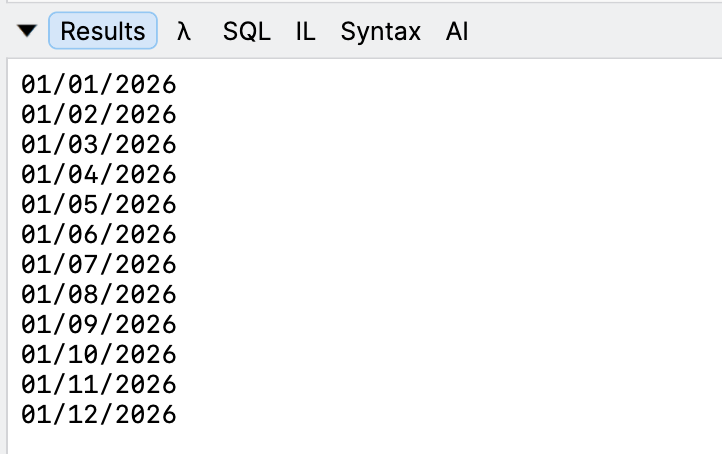

I recently needed to generate the **first day of each month**, for some processing in an algorithm.

The default approach would be this:

```c#
public IEnumerable<DateOnly> GetDatesInYear(int year)
{
  var start = new DateOnly(year, 1, 1);
  var temp = start;
  while (temp.Year == year)
  {
    yield return temp;
    temp = temp.AddMonths(1);
  }
}
```

**Straightforward** enough.

You can also achieve the same thing using a [LINQ](https://learn.microsoft.com/en-us/dotnet/csharp/linq/) expression.

```c#
public IEnumerable<DateOnly> GetDatesInYear(int year)
{
	return Enumerable.Range(1, 12).Select(x => new DateOnly(year, x, 1));
}
```

This can be **visualized** with this harness:

```c#
var year = 2026;
foreach (var date in GetDatesInYear(year))
{
	Console.WriteLine(date);
}
```



The code is in my [GitHub](https://github.com/conradakunga/BlogCode/tree/master/2026-10-11%20-%20FirstDayOfMonth).

Happy hacking!
