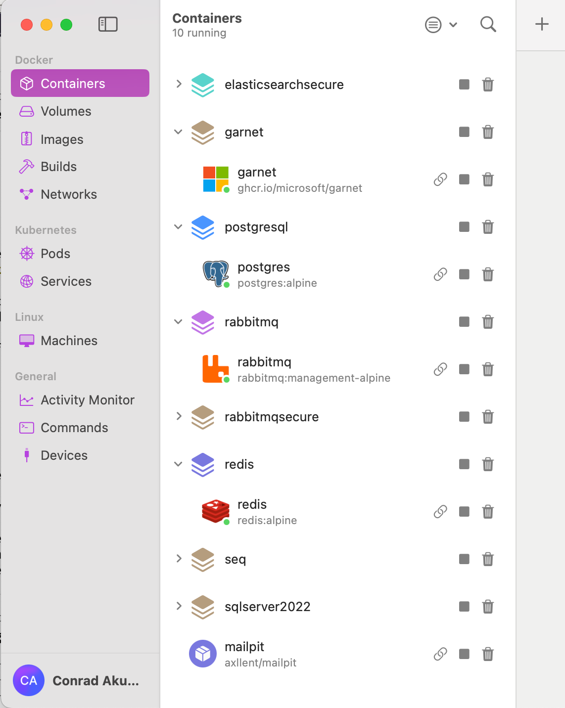
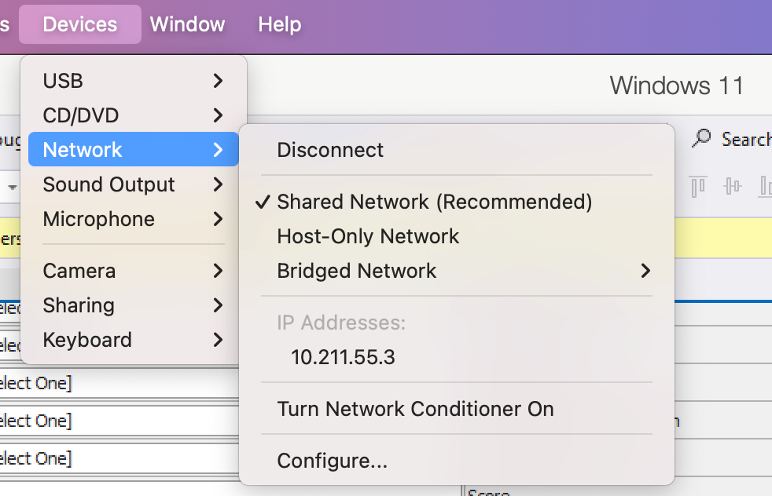

As I have mentioned a couple of times, my main computer is a [MacBook Pro](https://www.apple.com/ke/macbook-pro/) running on [macOS Sequoia](https://en.wikipedia.org/wiki/MacOS_Sequoia) 15.8.1. It has an [M3 Max](https://www.apple.com/ke/newsroom/2023/10/apple-unveils-m3-m3-pro-and-m3-max-the-most-advanced-chips-for-a-personal-computer/) chip and 64GB of RAM.

This is my daily driver.

I also do some [Windows](https://www.microsoft.com/en-us/windows) development.

For this, I use [Parallels Pro](https://www.parallels.com/products/desktop/pro/?srsltid=AU7gw4Ve2cr3x4sS7f6dnTFe72RVf6F_-EuWGN8KpooEVZZQbcQ5sWn4), in which I run a [Windows 11](https://en.wikipedia.org/wiki/Windows_11) virtual machine.

Given that the hardware is the M3, the Windows version that runs is the [Windows ARM version](https://support.microsoft.com/en-us/windows/experience/platform-variants/windows-arm-based-pcs-faq).

This has some key considerations, the main one being that a lot of software **does not run on the ARM** processor. Biggest examples off the top of my head are [Docker](https://www.docker.com/) (yet) and [Windows Subsystem for Linux (WSL).](https://github.com/microsoft/WSL)

This is generally not a problem.

Being a Mac, that natively runs Docker, whatever I need I run on Docker on the Mac side.

Which is actually more convenient because **I can access them from whatever OS I need them**.

Here is my current running stack:

For this to work, if I need to access [Redis](https://redis.io/) from the Windows side, I use an IP address in the `10.211.55.x` range.

In my case, the infrastructure on the Mac side is addressed at the `10.211.55.2` IP address.

This is through the magic of a **network** that Parallels creates.

**It is important to mention at this point that this network is only created if Parallels is actually running!**

If it doesn't, you will get the usual error that you get when the address you are trying to address is not on the network.

Many a minute I have spent wondering why an API suddenly isn't working. **This was the problem**.

I sporadically forget this and wonder why my services are timing out.

### TLDR

**Parallels only creates its network if it is actually running, so remember this when configuring IP addresses your services will point to.**

Happy hacking!
