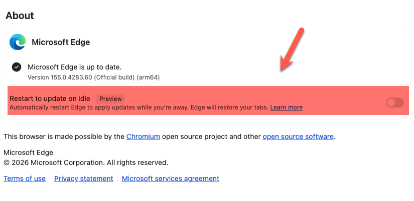

Today, after restarting [Microsoft Edge](https://explore.microsoft.com/en-us/edge) after an update, I noticed this in the about screen:

The idea is interesting from an application perspective, as it raises a couple of questions:

1. What constitutes "**idle**"
2. What happens if one (or more) of the tabs to be restored is not **restorable**? For example it was an email being edited?
3. **Would the user notice** this has happened? Will the original focused tab be restored as well?
4. Should, in fact, an application restart itself **without user input**?
5. If i have a tab **playing music or video in the background** - is that idle?

Food for thought!

### TLDR

**Is an app restarting itself after update a good thing?**

Happy hacking!
