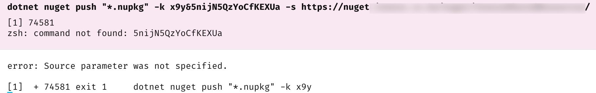
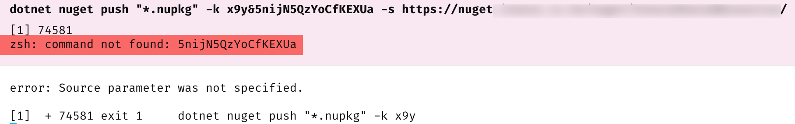

In some previous posts, "[Pushing NuGet Packages To An Online Repository with the NuGet Client]()" and "[Pushing NuGet Packages To An Online Repository with dotnet nuget]()" we looked at how to push [nuget](https://learn.microsoft.com/en-us/nuget/what-is-nuget) packages to repositories using either the native `Nuget` client, or the .net tool `dotnet nuget`.

To recap, the way to do this is as follows:

```bash
dotnet nuget push "*.nupkg" -k <YOUR KEY> -s <YOUR PATH>
```

Earlier today, I received the following error:



The clue is in the error:



The tool thinks the `&` in the key is the end of the key and the rest is **another command**.

The solution to this is simple - **enclose the key in quotes**.

```c#
dotnet nuget push "*.nupkg" -k "<YOUR KEY>" -s <YOUR PATH>
```

It should work perfectly now.

### TLDR

**When passing an API key to the dotnet nuget tool, enclose it in quotes.**

Happy hacking!
