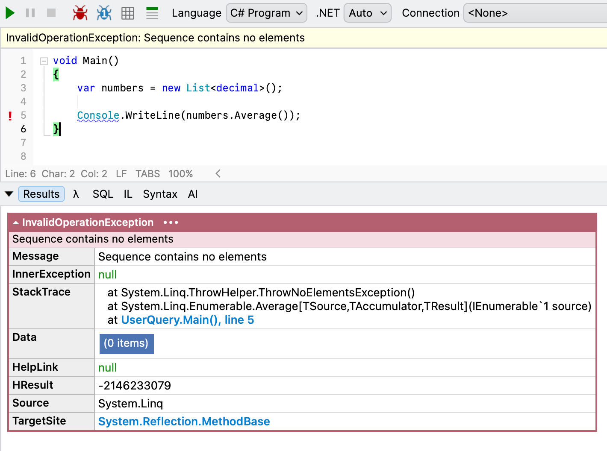

If you've used .NET in any incarnation, you have doubtlessly used [LINQ](https://learn.microsoft.com/en-us/dotnet/csharp/linq/) in some way, shape or form.

Recently, I was reviewing some code that reminded me again of the importance of **definitions**.

Quick, what does this code return?

```c#
var numbers = new List<decimal>();

Console.WriteLine(numbers.Average());
```

This is simply an attempt to compute the [average](https://en.wikipedia.org/wiki/Average) of a list of `decimal` that does not actually contain any numbers. **Average**, in some contexts, is also known as the [arithmetic mean](https://en.wikipedia.org/wiki/Arithmetic_mean).

Many would expect this to return a `0`.

It does not.

It, in fact, returns an [exception](https://learn.microsoft.com/en-us/dotnet/api/system.exception?view=net-10.0), and in particular, an [InvalidOperationException](https://learn.microsoft.com/en-us/dotnet/api/system.invalidoperationexception?view=net-10.0).



This is because the **average of a set without any elements is undefined**. There is a robust discussion of this topic here in [MathExchange](https://math.stackexchange.com/questions/909395/what-is-the-arithmetic-mean-of-no-numbers).

You therefore need to **code defensively** to avoid this problem.

```c#
var average = 0M;
if (numbers.Any())
	average = numbers.Average();

Console.WriteLine(average);
```

Alternatively, depending on your domain logic, you can throw an `Exception` if you detect an **empty set**.

### TLDR

The average of an empty set is undefined, so you need to check for this in your code.

Happy hacking!
