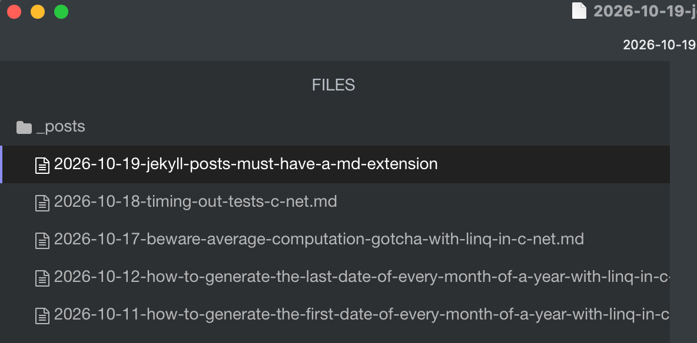
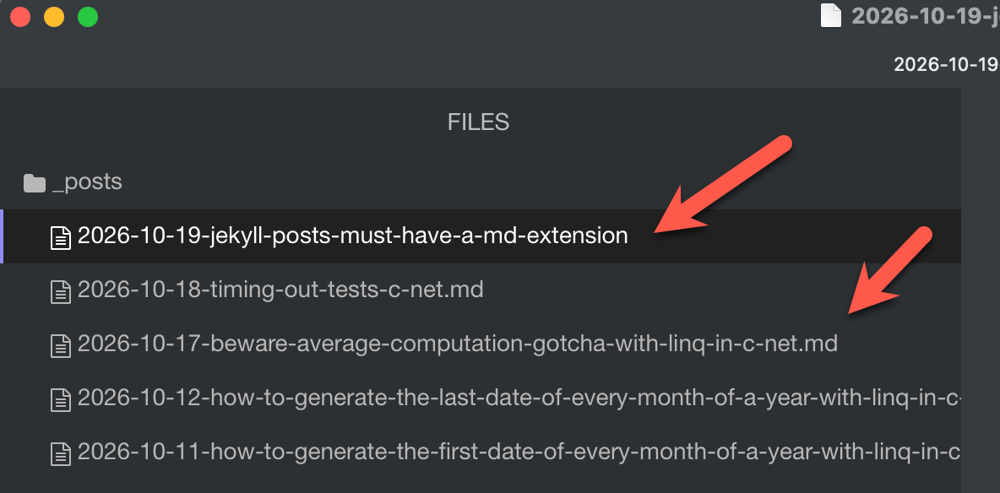

I have mentioned a couple of times that this site is generated using the [Jekyll](https://jekyllrb.com/) site generator.

I have had a very pleasant experience with this since [migrating]() from [WordPress](https://wordpress.com/).

However, it occasionally can **trip you up** if you are not paying attention

Quick, can you spot the **problem** here?

This is a screenshot of [Typora](https://typora.io/), my editor of choice.

In case you missed it, this is the **difference**:

The post **did not have an extension**.

I spent almost `15` **minutes** wondering why my post was **not being generated** until I realized that **Jekyll** ignores files that do not have the `.md` extension.

### TLDR

**Jekyll will ignore files that do not have the .md or .markdown extensions.**

Happy hacking!
