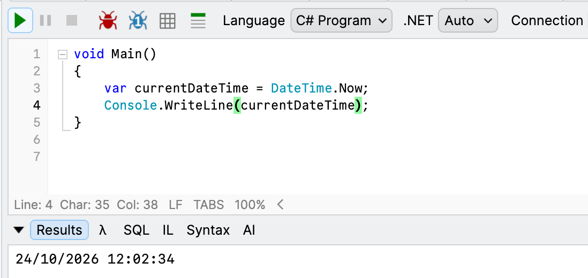
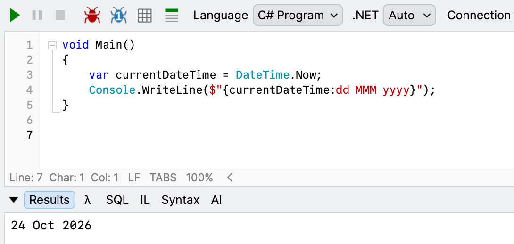
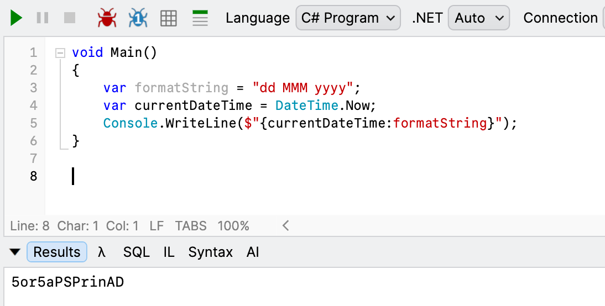
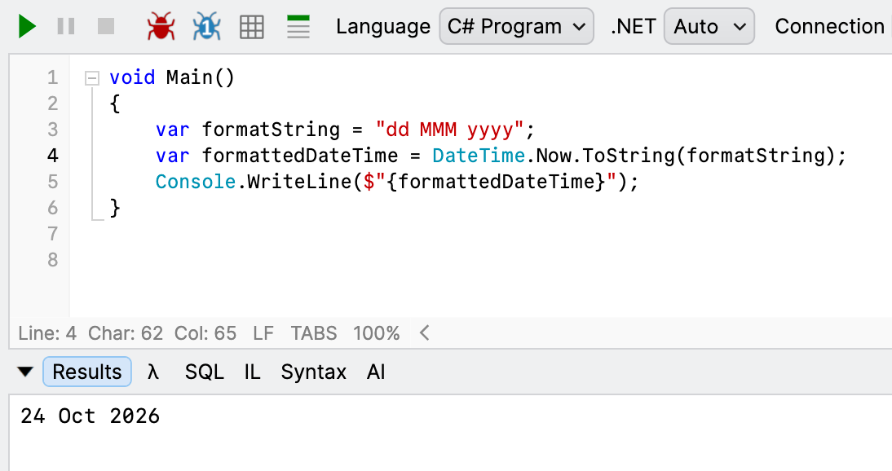

When **formatting** a [DateTime](https://learn.microsoft.com/en-us/dotnet/api/system.datetime?view=net-10.0), a [DateOnly](https://learn.microsoft.com/en-us/dotnet/api/system.dateonly?view=net-10.0) or a [TimeOnly](https://learn.microsoft.com/en-us/dotnet/api/system.timeonly?view=net-10.0), you typically pass a [format string](https://learn.microsoft.com/en-us/dotnet/standard/base-types/custom-date-and-time-format-strings) to help the user **interpret** the values.

For example, rather than this:

```c#
	var currentDateTime = DateTime.Now;
	Console.WriteLine(currentDateTime);
```



We do this:

```c#
var currentDateTime = DateTime.Now;
Console.WriteLine($"{currentDateTime:dd MMM yyyy}");
```



Suppose we wanted to supply the format string at **runtime**.

You might be tempted to do this:

```c#
var formatString = "dd MMM yyyy";
var currentDateTime = DateTime.Now;
Console.WriteLine($"{currentDateTime:formatString}");
```

This is **not correct**.

It's dangerous because **it will run but produce gibberish** depending on the `date` and `time`.



Using this syntax, the format string must be provided at **compile** time.

The proper way to do this is to **independently format** the [DateTime](https://learn.microsoft.com/en-us/dotnet/api/system.datetime?view=net-10.0) and provide that to the `string` interpolation.

We achieve this using the overload for [ToString](https://learn.microsoft.com/en-us/dotnet/api/system.datetime.tostring?view=net-10.0#system-datetime-tostring(system-string)) that accepts a format `string`.

```c#
var formatString = "dd MMM yyyy";
var formattedDateTime = DateTime.Now.ToString(formatString);
Console.WriteLine($"{formattedDateTime}");
```

This returns what we expect.



### TLDR

**To provide a format string at runtime for formatting, use the `ToString` method of the `DateTime`.**

Happy hacking!
