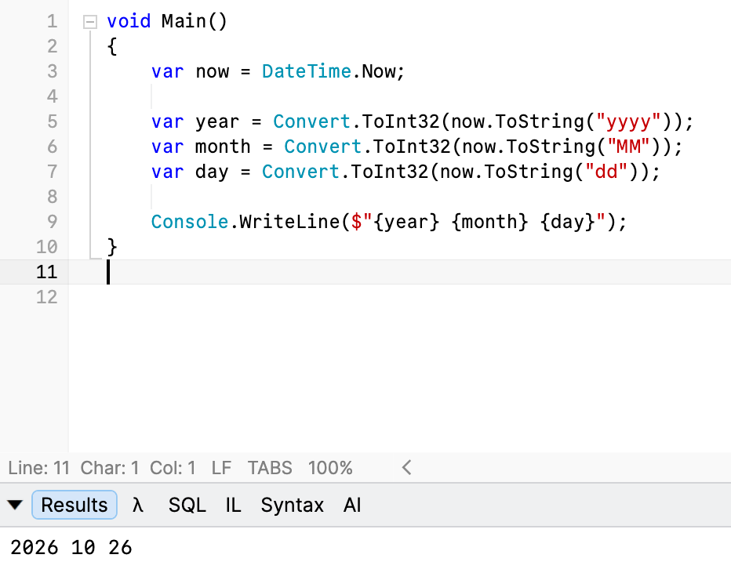

In a previous post, "[Deconstructing A DateTime To Day, Month & Year In C# & .NET]()", we looked at how to deconstruct a [DateTime](https://learn.microsoft.com/en-us/dotnet/api/system.datetime?view=net-10.0) into its `Date` and `Time` components.

In this post we will look at a similar problem - how to extract the **year**, **month** and **day** components from a `DateTime`.

This is for use in a downstream process that generates a hash with these values.

A straightforward way to achieve this is this:

```c#
// Get the date we are interested in
var now = DateTime.Now;

var year = Convert.ToInt32(now.ToString("yyyy"));
var month = Convert.ToInt32(now.ToString("MM"));
var day = Convert.ToInt32(now.ToString("dd"));

Console.WriteLine($"{year} {month} {day}");
```

The algorithm is pretty simple:

1. Use [format strings](https://learn.microsoft.com/en-us/dotnet/standard/base-types/standard-date-and-time-format-strings) to extract the components we are interested in
2. **Convert** these values to `integers`
3. **Store** the values in **variables** for future use.



This works.

But there is a simpler way - an overload for [Deconstruct](https://learn.microsoft.com/en-us/dotnet/api/system.datetime.deconstruct?view=net-10.0#system-datetime-deconstruct(system-int32@-system-int32@-system-int32@)) that returns the values we want.

```c#
var now = DateTime.Now;

now.Deconstruct(out var year, out var month, out var day);

Console.WriteLine($"{year} {month} {day}");
```

Much **cleaner**.

You can make it even **simpler** by doing it this way:

```c#
var now = DateTime.Now;

var (year, month, day) = now;

Console.WriteLine($"{year} {month} {day}");
```

Here we are using the native ability to [deconstruct into a named tuple](https://learn.microsoft.com/en-us/dotnet/csharp/fundamentals/types/tuples).

### TLDR

**There are number of techniques to use to extract the constituent parts of a `DateTime`.**

Happy hacking!
