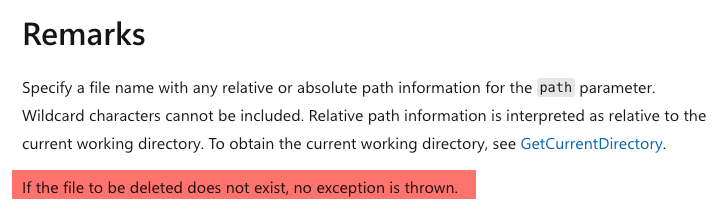

Was recently writing a small utility that needed to **generate** some files, **process** them, add them to a [zip](https://en.wikipedia.org/wiki/ZIP_(file_format)) archive, and then **delete** them.

Somewhere in the code was this line:

`````c#
File.Delete(filename)
`````

Pretty straightforward.

However, as I was debugging the code, I realized that `filename` **did not, in fact, exist**!

The runtime happily proceeded to **silently** execute that line and continue.

No [exception](https://learn.microsoft.com/en-us/dotnet/api/system.exception?view=net-10.0).

I found that intriguing.

Should you not throw an `exception` if the **file you want to delete doesn't exist**?

The first port of call was the [documentation](https://learn.microsoft.com/en-us/dotnet/api/system.io.file.delete?view=net-10.0):



Interesting.

This, I suppose, is one of those **philosophical questions**.

If the file you want to delete already isn't there, **is the inability to delete it an exception**?

### TLDR

**`File.Delete` for a file that does not exist does not throw an exception.**

Happy hacking!
