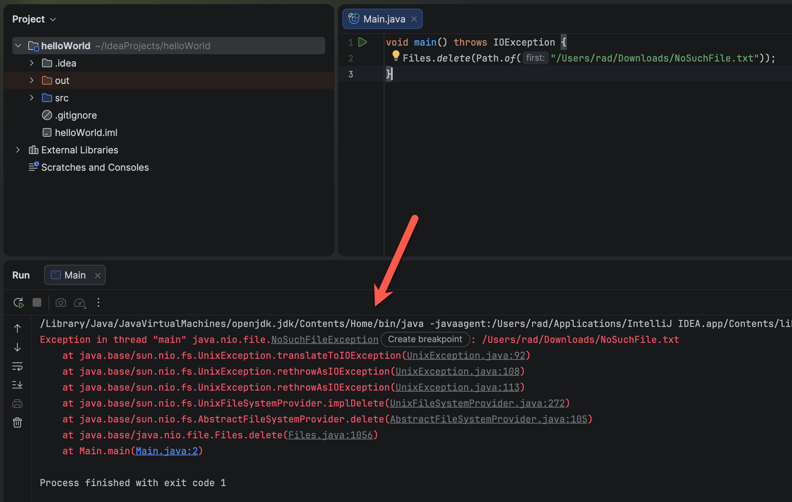
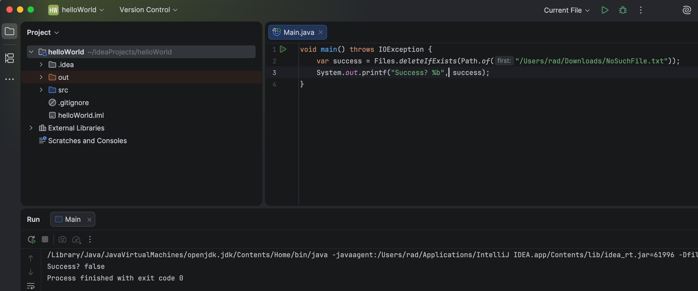

In yesterday's post, "[What Happens When You Do File.Delete For A Non-Existent File In C# & .NET]()", we looked at the intriguing fact that in [.NET](https://dotnet.microsoft.com/en-us/learn/dotnet/what-is-dotnet) **trying to delete a file that does not exist will not throw an `exception`**.

I wondered if the same was true for [Java](https://www.java.com/).

This is a one liner that is meant to **delete a file that I know for a fact does not exist**.

```java
void main() throws IOException {
   Files.delete(Path.of("/Users/rad/Downloads/NoSuchFile.txt"));
}
```

Here I am using the [NIO](https://docs.oracle.com/javase/8/docs/api/java/nio/package-summary.html) package as opposed to the traditional [java.io](https://docs.oracle.com/javase/8/docs/api/java/io/package-summary.html) package.

Running this yields the following:



So in Java, this is in fact an [exception](https://docs.oracle.com/javase/8/docs/api/java/nio/file/NoSuchFileException.html)!

But Java has an interesting **alternative** API - [deleteIfExists](https://docs.oracle.com/javase/8/docs/api/?java/nio/file/Files.html).

You'd use it like so:

```c#
void main() throws IOException {
    var success = Files.deleteIfExists(Path.of("/Users/rad/Downloads/NoSuchFile.txt"));
    System.out.printf("Success? %b", success);
}
```

There are no surprises when you run this code:



I understand the rationale behind **both** existing. It boils down to a single expection - **do you expect the file you want to delete to exist**? If so, then you might want a signal that it doesn't. In which case an exception is appropriate. Otherwise, **silence is golden**.

### TLDR

**Java NIO has two file deletion APIs you can call depending on your needs - `delete` and `deleteIfExists`**

Happy hacking!
