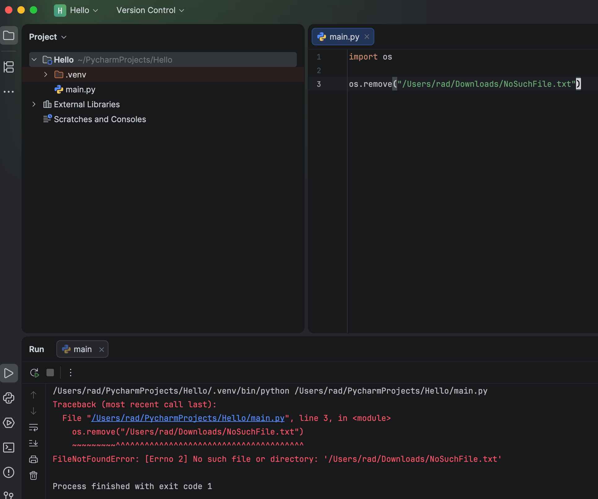

In some earlier posts, "What Happens When You Do File.Delete For A Non-Existent File In C# & .NET" and "What Happens When You Delete A Non-Existent File In Java", we looked at how **deletion of non existent files** was treated in [.NET](https://dotnet.microsoft.com/en-us/learn/dotnet/what-is-dotnet) and [Java](https://www.java.com/).

In this post, we will look at the same from [Python](https://www.python.org/).

The approach is pretty straightforward - import the [os](https://docs.python.org/3/library/os.html) module and then we write the code:

```python
import os

os.remove("/Users/rad/Downloads/NoSuchFile.txt")
```

When we run this code, we see the following:



We can see here that Python very much objects to deleting a file that does not exist.

A solution to this is to code defensively where we first check if the file exists before doing anything.

Like so:

```python
import os

file_name = "/Users/rad/Downloads/NoSuchFile.txt"

if os.path.exists(file_name):
    os.remove(file_name)

```

### TLDR

Python will throw an error if you try to delete a file that does not exist.

Happy hacking!
