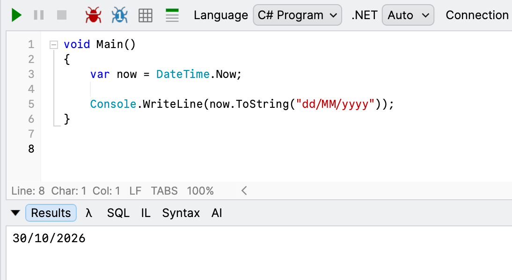
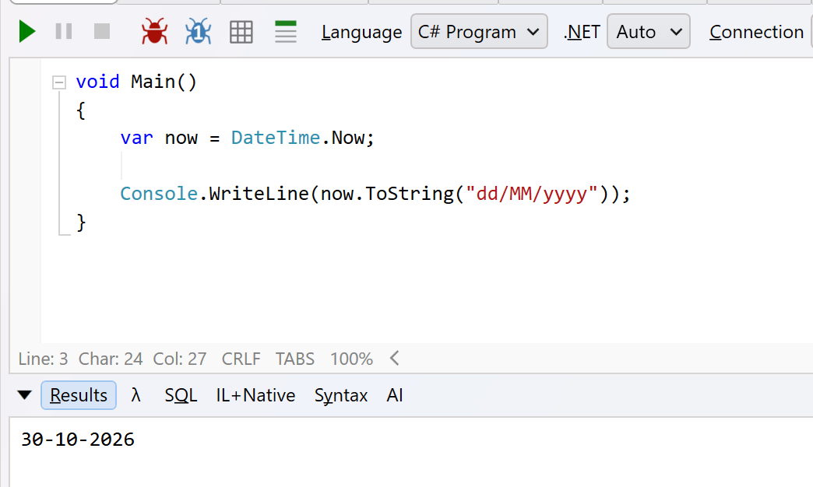
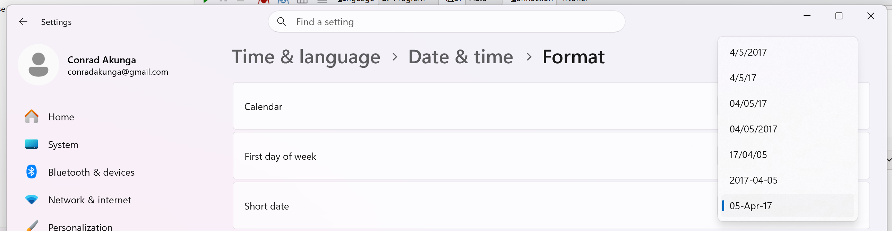
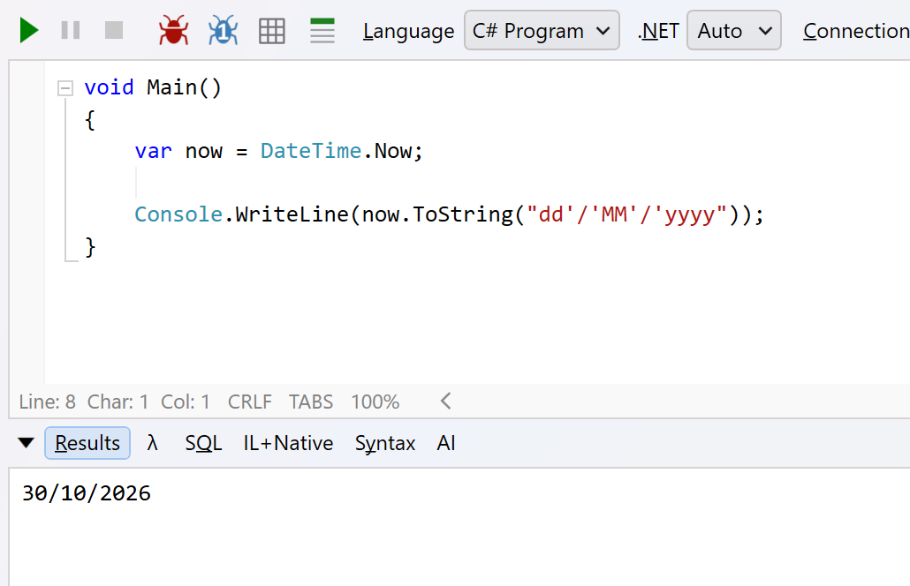

When working with [DateTime](https://learn.microsoft.com/en-us/dotnet/api/system.datetime?view=net-10.0) and [DateOnly](https://learn.microsoft.com/en-us/dotnet/api/system.dateonly?view=net-10.0) objects, you will inevitably end up [outputting](https://learn.microsoft.com/en-us/dotnet/standard/base-types/custom-date-and-time-format-strings) them. For this, you will generally need to use `/`, the [date separator](https://learn.microsoft.com/en-us/dotnet/api/system.globalization.datetimeformatinfo.dateseparator?view=net-10.0).

Something like this:

```c#
var now = DateTime.Now;

Console.WriteLine(now.ToString("dd/MM/yyyy"));
```

No surprises here.



But you need to remember that the `/` does not mean an actual **backslash** - it means **whatever date separator has been set at the operating system level**.

Here is the same code running in my Windows VM.



Note the result: `30-10-2026`.

This is because my VM has a **custom date format**.



This is a reminder that ``/` refers to the **date separator**, not necessarily a backslash.

Most of the time, you don't actually have to worry about this.

But recently I ran into a problem - I am generating a file, and the format for the date is expected to be `dd/MM/yyyy`.

My code correctly generates `30-10-2026,` which is technically correct, but wrong for my purposes.

There are a **couple** of solutions to this:

The first solution, for simple scenarios, is not to use the **DateSeparator** at all.

Specify the **date format** as follows: `dd'/'MM'/'yyyy`

Note here that the `/` is now just a normal, escaped character.

The code now looks like this:

```c#
void Main()
{
  var now = DateTime.Now;

  Console.WriteLine(now.ToString("dd'/'MM'/'yyyy"));
}


```

The code will now run as expected, regardless of the configured **date separator**.



But this is a very **hacky** solution for **one-off** use.

We'll implement the **proper** solution in our next post.

### TLDR

**The `/` in a date format string refers to the currently configured operating system date separator.**

Happy hacking!
