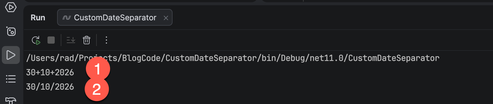
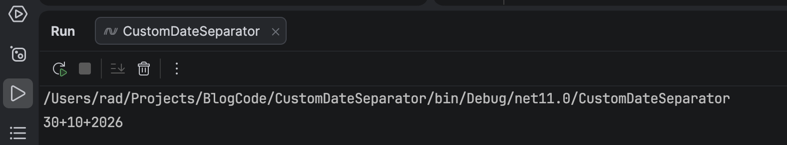

In our previous post, "[Working With `/` The Date Separator In C# & .NET]()", we looked at the interpretation of the [DateSeparator](https://learn.microsoft.com/en-us/dotnet/api/system.globalization.datetimeformatinfo.dateseparator?view=net-10.0) and how to **force display of a particular symbol**.

In this post we will look at how to do it **properly**.

We will take the strategy I first outlined in the post "[Dynamically Changing Date Separators At Runtime]()", where we took an existing [culture](https://learn.microsoft.com/en-us/dotnet/api/system.globalization.cultureinfo?view=net-10.0) and **modified it for our purposes**.

Here we are going to extract the [DateTimeFormatInfo](https://learn.microsoft.com/en-us/dotnet/api/system.globalization.datetimeformatinfo?view=net-10.0) for the current culture, and **modify** it to change the [DateSeparator](https://learn.microsoft.com/en-us/dotnet/api/system.globalization.datetimeformatinfo.dateseparator?view=net-10.0). For our case we want to use the `+` as a **date separator**.

```c#
using System.Globalization;

// Clone the existing culture and extract the DateTimeFormatInfo
var dateTimeFormatInfo = (DateTimeFormatInfo)
    CultureInfo.InvariantCulture.DateTimeFormat.Clone();

// Modify what we want to change - the date separator
dateTimeFormatInfo.DateSeparator = "+";

// Now, when formatting, specify our format

Console.WriteLine(DateTime.Now.ToString("dd/MM/yyyy", dateTimeFormatInfo));

Console.WriteLine(DateTime.Now.ToString("dd/MM/yyyy"));
```

If you run this code you will see **good** news and **bad** news.



1. When we **remember** to pass the culture, it does what we want
2. If we **forget**, we get the default behaviour

This is not ideal.

The proper solution is to **directly modify the culture**.

We shall do that as follows:

1. **Clone** the current culture, or **create one that may be more suited**  as a base
2. **Modify** whatever you need
3. Set the [Thread's](https://learn.microsoft.com/en-us/dotnet/api/system.threading.thread?view=net-10.0) [current culture](https://learn.microsoft.com/en-us/dotnet/api/system.threading.thread.currentculture?view=net-10.0) to our new custom culture
4. Forget about formatting issues

```c#
using System.Globalization;

// Clone the current culture, to use as a base
var culture = CultureInfo.InvariantCulture.Clone() as CultureInfo;

// Modify what we want to change - the date separator
culture!.DateTimeFormat.DateSeparator = "+";

// Set the thread's culture to our new culture
Thread.CurrentThread.CurrentCulture = culture;

// Work as normal
Console.WriteLine(DateTime.Now.ToString("dd/MM/yyyy"));
```



You can see here that we now **don't need to pass anything** to our [ToString](https://learn.microsoft.com/en-us/dotnet/api/system.datetime.tostring?view=net-10.0#system-datetime-tostring(system-string)) overload - the runtime natively knows what to use as a `DateSeparator`.

### TLDR

**To avoid having to pass [Cultures](https://learn.microsoft.com/en-us/dotnet/api/system.globalization.cultureinfo?view=net-10.0) to your code when formatting, change the [CurrentCutlure](https://learn.microsoft.com/en-us/dotnet/api/system.globalization.cultureinfo.currentuiculture?view=net-10.0) directly to be one with all your configurations made.**

The code is in my GitHub.

Happy hacking!
