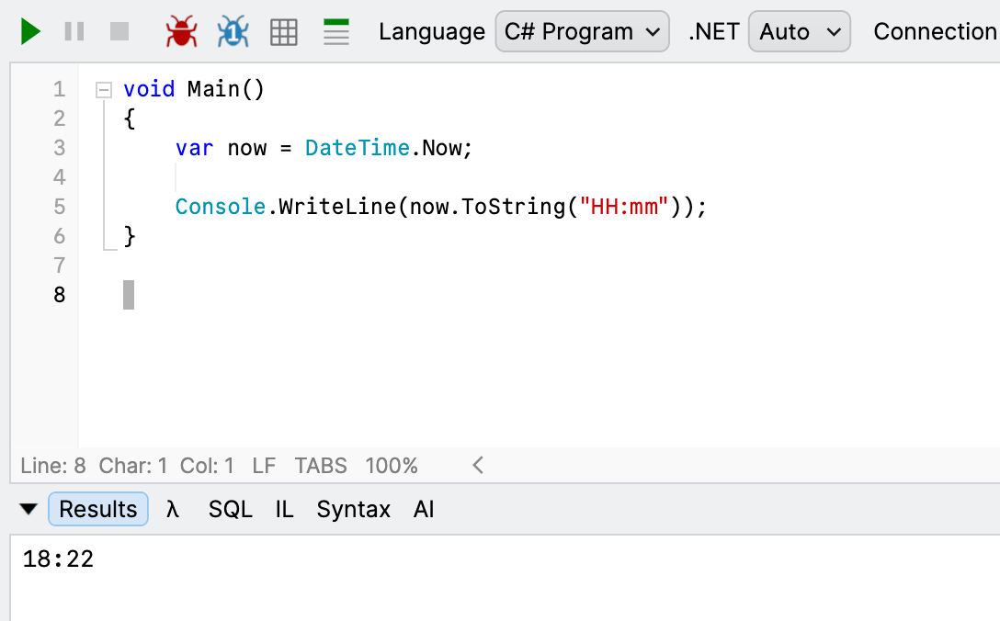
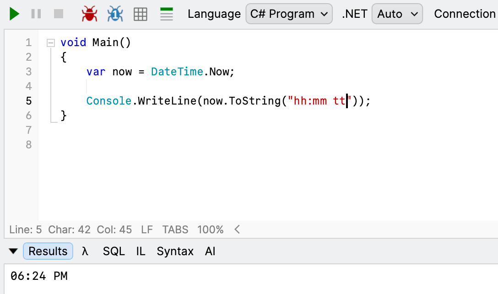
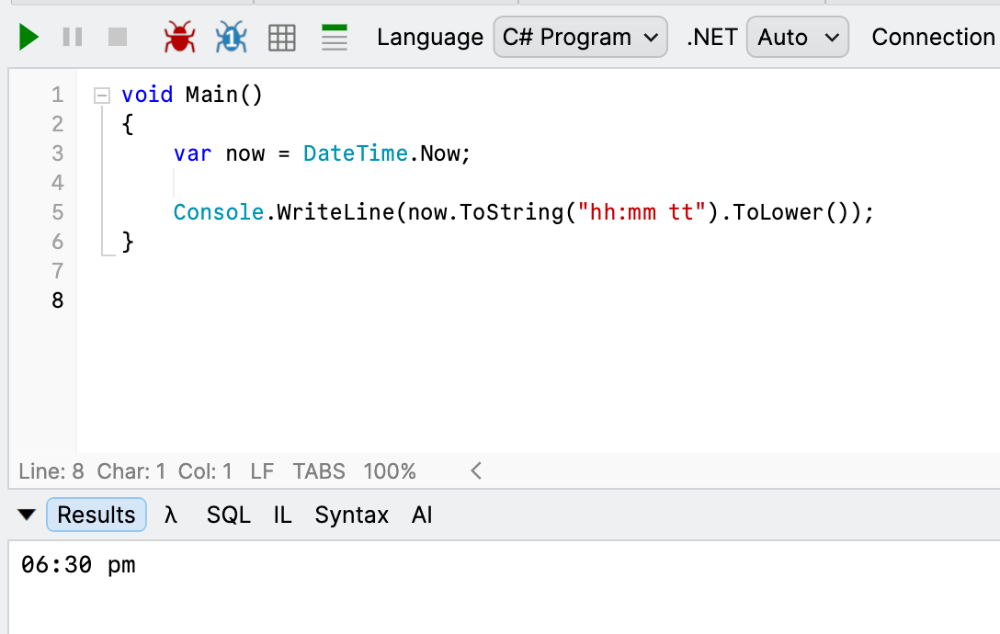

When displaying the time, you have two options:

1. [24 hour clock](https://en.wikipedia.org/wiki/24-hour_clock)
2. [12 hour clock](https://en.wikipedia.org/wiki/12-hour_clock)

To display the time using the **24 Hour clock**, you would do it like this:

```c#
var now = DateTime.Now;

Console.WriteLine(now.ToString("HH:mm"));
```

This will print the following:



To display the time using the 12-hour clock, we would do it like this:

```c#
var now = DateTime.Now;

Console.WriteLine(now.ToString("hh:mm tt"));
```

This will print the following:



The format string for the AM/PM designator is `tt`, which you can read about [here](https://learn.microsoft.com/en-us/dotnet/standard/base-types/standard-date-and-time-format-strings#ShortTime).

Recently, a client requested the time to be formatted like this - `06:24 pm`

Note here that the `pm` is in **lower case**.

I wondered whether there was a way to modify the format string to output this.

**There isn't**.

The quick and dirty way is to lower case the entire string.

```c#
var now = DateTime.Now;

Console.WriteLine(now.ToString("hh:mm tt").ToLower());
```

This outputs what we would expect:



Is there a more robust way of doing this? Of course. We shall look at that in our next post.

### TLDR

**To quickly output am/pm in lower case, change the entire time as a `string` to *lowercase*.**

Happy hacking!
