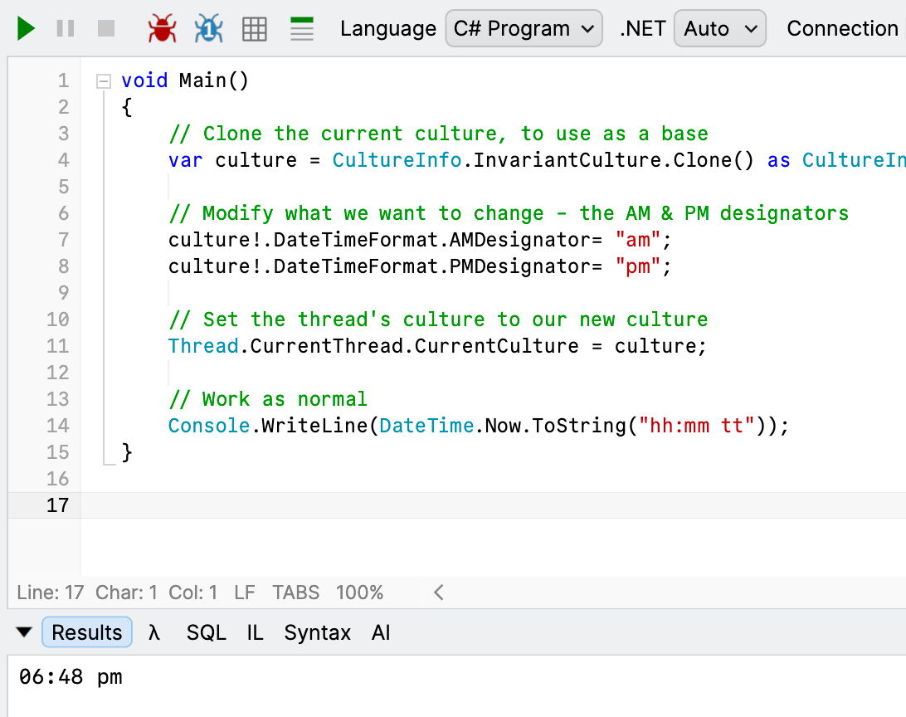
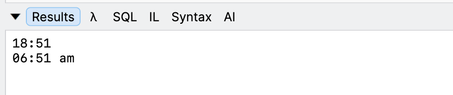

In our previous post, "[Displaying AM/PM In Lower Case In C# & .NET]()", we looked at a quick-and-dirty way to display the time with the **am/pm designator in lower case**, like this - `06:13 pm`.

In today's post, we will look at how to do this **globally**.

For this we will use the technique outlined in the post "[Dynamically Changing Date Separators at Runtime in C# & .NET]()" where we customize a locale and use that globally in the current thread.

```c#
// Clone the current culture, to use as a base
var culture = CultureInfo.InvariantCulture.Clone() as CultureInfo;

// Modify what we want to change - the AM & PM designators
culture!.DateTimeFormat.AMDesignator= "am";
culture!.DateTimeFormat.PMDesignator= "pm";

// Set the thread's culture to our new culture
Thread.CurrentThread.CurrentCulture = culture;

// Work as normal
Console.WriteLine(DateTime.Now.ToString("hh:mm tt"));
```

The magic is taking place here:

```c#
// Modify what we want to change - the AM & PM designators
culture!.DateTimeFormat.AMDesignator= "am";
culture!.DateTimeFormat.PMDesignator= "pm";
```

We are setting the fields [AMDesignator](https://learn.microsoft.com/en-us/dotnet/api/system.globalization.datetimeformatinfo.amdesignator?view=net-10.0) and [PMDesignator](https://learn.microsoft.com/en-us/dotnet/api/system.globalization.datetimeformatinfo.pmdesignator?view=net-10.0) to what we want.

The code runs as we would expect:



If you are of a particularly **malicious** bent, you can do something like this:

```c#
// Modify what we want to change - the AM & PM designators
culture!.DateTimeFormat.AMDesignator= "pm";
culture!.DateTimeFormat.PMDesignator= "am";
```

Here we have **swapped the designators**!

This means this code:

```c#
Console.WriteLine(DateTime.Now.ToString("HH:mm"));
Console.WriteLine(DateTime.Now.ToString("hh:mm tt"));
```

Prints the following:



Don't try this at home!

### TLDR

**You can customize your AM/PM designator at an application level.**

Happy hacking!
