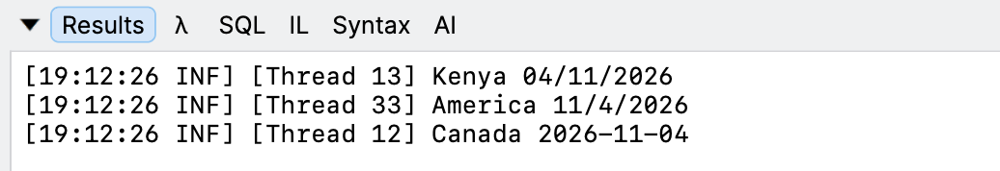

As outlined in [some]() [earlier]() [posts](), you can set the locale of the current [thread]() to whichever one you want.

We can leverage this if we need to process data from **multiple locales in the same application**.

Let us take a **trivial** example where we want to **process some code in 3 different locales**:

1. Kenyan English (`en-ke`)
2. French Canadian (`fr-CA`)
3. USA (en-US)

The strategy here is to create `3` different `threads` and customize them before processing.

Our code would look something like this:

```c#
// Use Serilog console sink with a thread enricher to display the Thread ID	
Log.Logger = new LoggerConfiguration()
  // Enrich
  .Enrich.WithThreadId()
  // Customize output template
  .WriteTo.Console(outputTemplate:
  "[{Timestamp:HH:mm:ss} {Level:u3}] [Thread {ThreadId}] {Message:lj}{NewLine}{Exception}")
  .CreateLogger();

var now = DateTime.Now;

// Create our tasks
var kenyan = Task.Run(() =>
{
  Thread.CurrentThread.CurrentCulture = new CultureInfo("en-KE");
  Log.Information("{Country} {Date}", "Kenya", now.ToShortDateString());
  // Custom processing here
});

var canada = Task.Run(() =>
{
  Thread.CurrentThread.CurrentCulture = new CultureInfo("fr-CA");
  Log.Information("{Country} {Date}", "Canada", now.ToShortDateString());
  // Custom processing here
});

var america = Task.Run(() =>
{
  Thread.CurrentThread.CurrentCulture = new CultureInfo("en-US");
  Log.Information("{Country} {Date}", "America", now.ToShortDateString());
  // Custom processing here
});

// Await all our threads
await Task.WhenAll(kenyan, canada, america);
```

If we run this code, it will print something like this:



Here, we can see that each print output ran in a **different** `thread`, within which we set our c**ustom locale**.

In this way, we can write an application that **accepts and processes data** from users with **different locales**.

### TLDR

**Leverage the fact that localization can he set at the thread level to allow building of robust, culturally aware applications.**

The code is in my GitHub.

Happy hacking!
