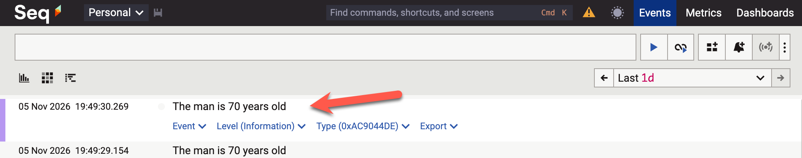
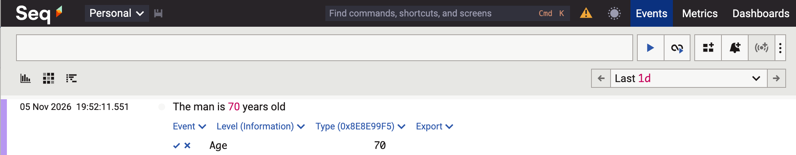
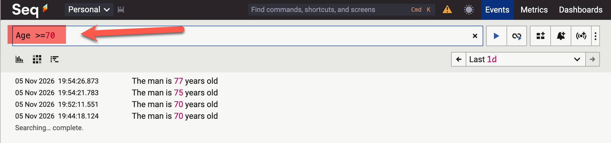
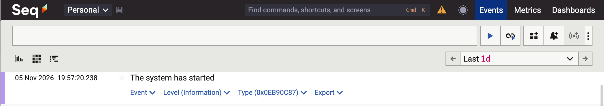
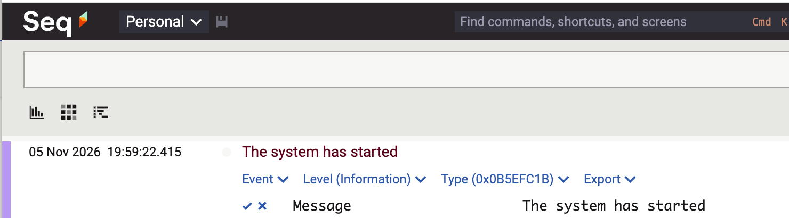

I have often mentioned that my **logging** library of choice is [Serilog](https://serilog.net/).

I use this in conjunction with its rich **ecosystem** of [sinks](https://github.com/serilog/serilog/wiki/provided-sinks), in particular:

- [Seq](https://nuget.org/packages/serilog.sinks.seq)
- [ElasticSearch](https://www.elastic.co/docs/reference/ecs/logging/dotnet/serilog-data-shipper)
- [Console](https://nuget.org/packages/serilog.sinks.console)

One reason is its support for [structured logging](https://github.com/serilog/serilog/wiki/structured-data).

Take this scenario.

1. You have a **man**.
2. The man has an **age**
3. You want to **log** this for future reference

First, we set up our logging **infrastructure**:

```c#
Log.Logger = new LoggerConfiguration()
  .WriteTo.Seq("http://localhost:5341")
  .CreateLogger();
```

Here, I want to log to [Seq](https://datalust.co/).

Your initial instinct would be to do it like this:

```c#
Log.Information("The man is {Age} years old", 70);
```

This works.

Kind of.



Imagine you have **thousands** of entries and you want to **find men older then a particular age**.

This is a **nightmare**.

The solution to this is **structured logging**.

We achieve it like so:

```c#
Log.Information("The man is {Age} years old", 70);
```

The result is as follows:


It looks the same, you might say, except the age is in red.

Not quite.

You can **expand the entry and view structured properties** that you have requested to be logged:



This allows you to do things like this:



You can slice, dice and analyze your data based on your logged properties.

Which is very powerful.

How this works is that the parameter to a `Log` object is **not actually a string**, but a message **template**.

Which normally isn't an issue.

Unless you have a situation where you want to log a `string` as is.

```c#
Log.Information("The system has started");
```



This is easy to understand for you and me, but for Serilog, it **is still a message template** without any parameters.

A solution to this is to **treat the entirety of your message as a parameter**,

Like so:

```c#
Log.Information("{Message:l}", "The system has started");
```

The `l` here means **log the string literally**.

This will get logged as follows:



Here you get the **best of both worlds** - you can filter the **logged text,** but also **segregate your logged messages**.

### TLDR

**To log literal messages, use the `l` placeholder. Don't use the `Log.XXX` methods and passing them a `string`.**

Happy hacking!
