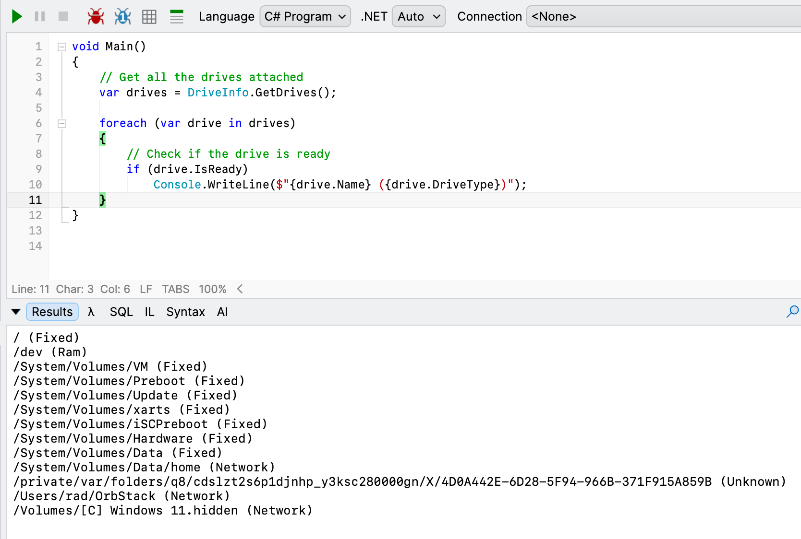

Recently, I needed to access and **enumerate all the drives attached to my main computer**, a [MacBook Pro](https://www.apple.com/ke/macbook-pro/) running macOS [Sonoma](https://en.wikipedia.org/wiki/MacOS_Sonoma).

This can be achieved using the [GetDrives](https://learn.microsoft.com/en-us/dotnet/api/system.io.driveinfo.getdrives?view=net-10.0) method of the [DriveInfo](https://learn.microsoft.com/en-us/dotnet/api/system.io.driveinfo?view=net-10.0) class, which returns a collection of `DriveInfo` objects.

You can then **iterate** over the list and access whatever information you want.

During iteration, check whether the drive is ready by examining its `IsReady` property. This is because some drives may be **connected**, but not actually in a position to be **interrogated**; for example, a DVD drive that does not actually have a DVD.

The code is as follows:

```c#
// Get all the drives attached
var drives = DriveInfo.GetDrives();

foreach (var drive in drives)
{
  // Check if the drive is ready	
  if (drive.IsReady)
  	Console.WriteLine($"{drive.Name} ({drive.DriveType})");
}
```

This will print something like this:



We can see that the runtime finds all attached drives, including **hidden** and **system** ones.

If I run the same code on **Windows**, I get the following result:


### TLDR

**The `DriveInfo` class contains methods and properties allowing interrogation of attached drives.**
