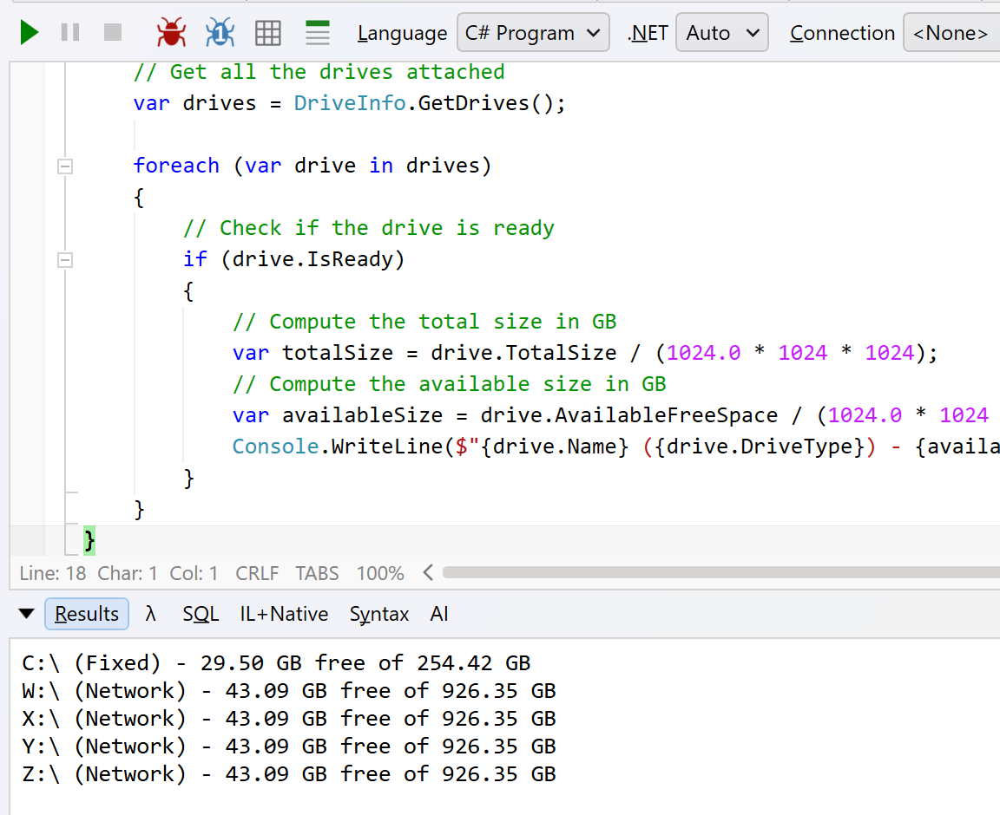

In our previous post, "[Getting the Connected Drives in C# & .NET]()", we looked at how to get the **available drives** attached to a computer.

In this post, we will look at how to **check for total and available space**.

The solution, naturally, is still in the [DriveInfo](https://learn.microsoft.com/en-us/dotnet/api/system.io.driveinfo?view=net-10.0) class.

The properties we need are:

- [AvailableFreeSpace](https://learn.microsoft.com/en-us/dotnet/api/system.io.driveinfo.totalfreespace?view=net-10.0)
- [TotalSize](https://learn.microsoft.com/en-us/dotnet/api/system.io.driveinfo.totalsize?view=net-10.0)

The code is as follows:

```c#
// Get all the drives attached
var drives = DriveInfo.GetDrives();

foreach (var drive in drives)
{
  // Check if the drive is ready	
  if (drive.IsReady)
  {
    // Compute the total size in GB
    var totalSize = drive.TotalSize / (1024.0 * 1024 * 1024);
    // Compute the available size in GB
    var availableSize = drive.AvailableFreeSpace / (1024.0 * 1024 * 1024);
    Console.WriteLine($"{drive.Name} ({drive.DriveType}) - {availableSize:#,0.00} GB free of {totalSize:#,0.00} GB");
  }
}
```

Running this code yields the following on **macOS**:


On **Windows**:



Notably, drives like **shares** show the **underlying information of the drive they are mapped to**. For example, the `926.35` GB here is the main drive that is hosting my Windows VM.

### TLDR

**The `DriveInfo` class exposes `AvailableFreeSpace` and `TotalSpace` properties to get information about the usage of your drives.**

The code is in my GitHub.

Happy hacking!
