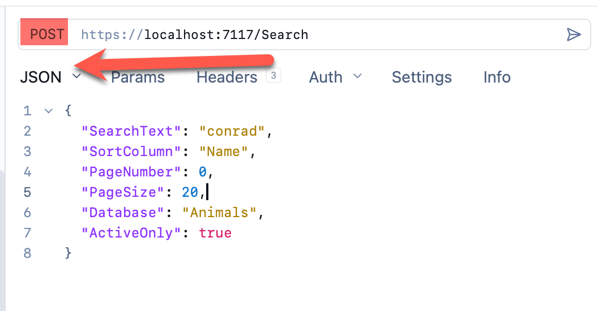
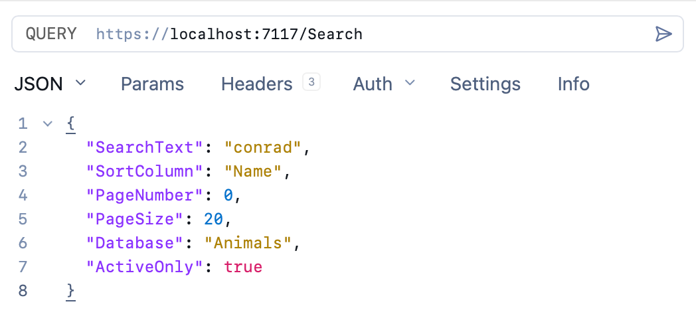

When it comes to **sending data to a web server** over the web, you have a couple of **options**:

1. Sending data within the **URL**
    1. [GET](https://developer.mozilla.org/en-US/docs/Web/HTTP/Reference/Methods/GET)
    2. [DELETE](https://developer.mozilla.org/en-US/docs/Web/HTTP/Reference/Methods/DELETE)
2. Sending data within the `HTTP` **body**
    1. [POST](https://developer.mozilla.org/en-US/docs/Web/HTTP/Reference/Methods/POST)
    2. [PUT](https://developer.mozilla.org/en-US/docs/Web/HTTP/Reference/Methods/PUT)
    3. [PATCH](https://developer.mozilla.org/en-US/docs/Web/HTTP/Reference/Methods/PATCH)

These generally map as follows for a [RESTful API](https://aws.amazon.com/what-is/restful-api/)

| Operaton    | Method         |
| ----------- | -------------- |
| Fetch data  | `GET`          |
| Insert data | `POST`         |
| Update Data | `PUT`, `PATCH` |
| Delete data | `DELETE`       |

The greatest strength of `GET` can also be its greatest weakness.

Given that data is passed in the URL, this means you can easily implement **caching** on the server side, either at the **web server level** or at the **API level**, as you can use the entire URL as a key. **Browsers** and other web **clients** can also **natively support response caching** to minimize traffic.

The problem is that the URL has some **hard limits** in terms of:

1. Size
2. Data representation

**Size** is a bit complex. The [HTTP specification](https://developer.mozilla.org/en-US/docs/Web/HTTP/Reference/Resources_and_specifications) does not actually set a **maximum size**, so implementation is left to the mercy of **browsers** and **web servers**.

For **browsers**, [Chrome](https://www.google.com/chrome/), and other [Chromium](https://www.chromium.org/) based browsers like [Microsoft Edge](https://explore.microsoft.com/en-us/edge) have a [hard limit of 2,097,152 characters](https://chromium.googlesource.com/chromium/src/+/main/docs/security/url_display_guidelines/url_display_guidelines.md), about `2MB`. Firefox has a limit of about `65,536` (`64 KB`). [Safari](https://www.apple.com/safari/), based on chrome, has a limit of `80,000`.

For **web servers**, you have a different set of constraints. [Microsoft IIS](https://www.iis.net/) has a [default length](https://learn.microsoft.com/en-us/iis/configuration/system.webserver/security/requestfiltering/requestlimits/) limit of `4KB`. [Apache](https://httpd.apache.org/) has a limit ranging from `8,000` to `128,000` bytes. [Nginx](https://nginx.org/) has a [default length](https://nginx.org/en/docs/http/ngx_http_core_module.html) of '8KB'.

When it comes to **representation**, you have a different problem, given that the URL is basically a `string`.

You cannot, for example, pass `JSON` in a URL without doing some **encoding** first, perhaps in [Base64](https://en.wikipedia.org/wiki/Base64).

This basically means you can quickly run into **hard limits** when you have **large payloads**, not to mention **inconsistencies between servers and browsers**.

This is over and above the challenge of **encoding data** to be represented in the query string.

For example, if your API supports **search**, the payload would look like this:

```json
{
  "SearchText": "conrad",
  "SortColumn": "Name",
  "PageNumber": 0,
  "PageSize": 20,
  "Database": "Animals",
  "ActiveOnly": true
}
```

You would therefore need to **convert** this to a `string` so that you can submit in a URL.

To avoid having to deal with all these problems, a simple solution is to **abandon** the `GET` together and use a `POST`.

Given that the data is passed in the **header**, `POST` out of the box can support object as is.



However, `POST` has a number of **drawbacks** for this use case:

1. `POST` is by convention expected to **modify state**, generally to **create** a new entity
2. **Caching** of `POST` requests on the server side is technically possible, but requires some **extra effort** to correctly setup and work.

It is for this reason that the [QUERY](https://developer.mozilla.org/en-US/docs/Web/HTTP/Reference/Methods/QUERY) method has been introduced, as outlined in [RFC 10008](https://www.rfc-editor.org/info/rfc10008/).

It has be best of both worlds:

1. **Request** has a **body**, like `POST`
2. Can be **cached**, like `GET`
3. Can be treated as **Idempotent**, like `GET`
4. **Response** comes back in the **body**, like `GET`
5. Does not **alter server state**, like `GET`

Recent builds modern browsers and tools support this.



This is my goto API Client, [Yaak](https://yaak.app/).

### TLDR

**`HTTP` `QUERY` allows you to have `GET` semantics for payloads with a body**

Happy hacking!
