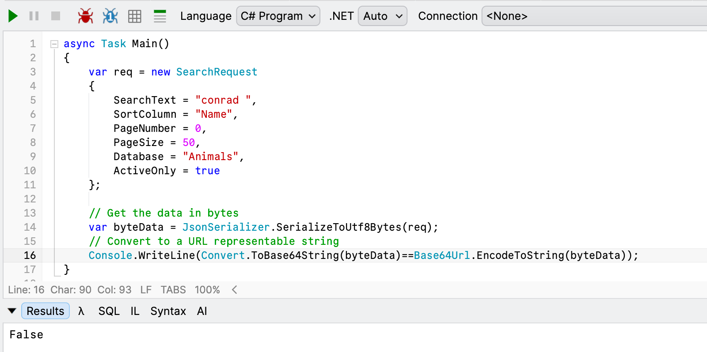
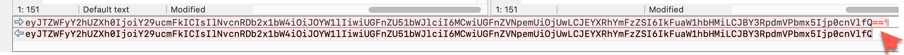

A common protocol for **encoding data** for safe representation as a `string` is [Base64](https://en.wikipedia.org/wiki/Base64). You typically need this for **encoding arbitrary data** over a channel that expects **text**, such as **email**.

The go-to for this is typically the [Convert](https://learn.microsoft.com/en-us/dotnet/api/system.convert?view=net-10.0) class, which has a [ToBase64String](https://learn.microsoft.com/en-us/dotnet/api/system.convert.tobase64string?view=net-10.0) method. If you want a `character` array instead, you can use the [ConvertToBase64CharArray](https://learn.microsoft.com/en-us/dotnet/api/system.convert.tobase64chararray?view=net-10.0) method.

Let us use the **example** from the previous post, "[How To Encode An Object For Passing In A URL In C# & .NET]()".

```c#
public sealed class SearchRequest
{
  public required string SearchText { get; init; }
  public required string SortColumn { get; init; }
  public required int PageNumber { get; init; }
  public required int PageSize { get; init; }
  public required string Database { get; init; }
  public required bool ActiveOnly { get; init; }
}

```

We create an `object` like this:

```c#
var req = new SearchRequest
{
  SearchText = "conrad",
  SortColumn = "Name",
  PageNumber = 0,
  PageSize = 50,
  Database = "Animals",
  ActiveOnly = true
};
```

We need to get this `object` as a `byte` `array`.

A simple solution is to use the `JsonSerializer`

```c#
// Get the data in bytes
var byteData = JsonSerializer.SerializeToUtf8Bytes(req);
```

Finally, we **encode** this:

```c#
var encodedByteData = Convert.ToBase64String(byteData);
```

Simple enough.

There is also another `class` that can do this - [Base64Url](https://learn.microsoft.com/en-us/dotnet/api/system.buffers.text.base64url?view=net-10.0), which has an [EncodeToString](https://learn.microsoft.com/en-us/dotnet/api/system.buffers.text.base64url.encodetostring?view=net-10.0) method. 

```c#
var encodedByteData = Base64Url.EncodeToString(byteData);
```

This is in fact what we did in our [previous post]().

Now, you might ask, what is the **difference**?

Let us first compare the outputs:

```c#
var byteData = JsonSerializer.SerializeToUtf8Bytes(req);
// Convert to a URL representable string
Console.WriteLine(Convert.ToBase64String(byteData) == Base64Url.EncodeToString(byteData));
```

This will print `true`, indicating that the outputs are the **same**.

Now, let us **modify** our data slightly:

We will change our search text from `conrad` to `conrad ` (here are **two spaces after the end** of the string)



Let us now visualize the actual outputs:

```plaintext
eyJTZWFyY2hUZXh0IjoiY29ucmFkICIsIlNvcnRDb2x1bW4iOiJOYW1lIiwiUGFnZU51bWJlciI6MCwiUGFnZVNpemUiOjUwLCJEYXRhYmFzZSI6IkFuaW1hbHMiLCJBY3RpdmVPbmx5Ijp0cnVlfQ==
eyJTZWFyY2hUZXh0IjoiY29ucmFkICIsIlNvcnRDb2x1bW4iOiJOYW1lIiwiUGFnZU51bWJlciI6MCwiUGFnZVNpemUiOjUwLCJEYXRhYmFzZSI6IkFuaW1hbHMiLCJBY3RpdmVPbmx5Ijp0cnVlfQ
```

The top is from `Convert` and the bottom is from `Base64Uri`

Its tricky to see but the difference is this:



That `=` that is a part of the `Convert` output is the issue. This is a **special character** that the encoding inserts to **pad the output** to ensure the length is a multiple of `4` bytes.

Which is precisely the problem [Base64Url.EncodeToString](https://learn.microsoft.com/en-us/dotnet/api/system.buffers.text.base64url.encodetostring?view=net-10.0) is solving - it removes these characters for you.

You will get the same problem with these characters:

- `+`, that is a **space** in a query string
- `/` that is a **path** in a query string

The specification, [RFC 4648](https://www.rfc-editor.org/info/rfc4648/), specifies what to do when encountering this data - which is **replacing** it with other characters: `+` is replaced with `-`, and `/` is replaced with `_`

If you use `Convert.ToBase64String`, **you must replace these yourself**. [Base64Url.EncodeToString](https://learn.microsoft.com/en-us/dotnet/api/system.buffers.text.base64url.encodetostring?view=net-10.0) **does this for you**.

```c#
var encodedByteData = Convert.ToBase64String(byteData);
    .TrimEnd('=')
    .Replace('+', '-')
    .Replace('/', '_');
```

### TLDR

**For passing Base64 data over a URL, use Base64Url.EncodeToString instead of `Convert.ToBase64String,` as it does some replacements automatically for you.**

The code is in my GitHub.

Happy hacking!
