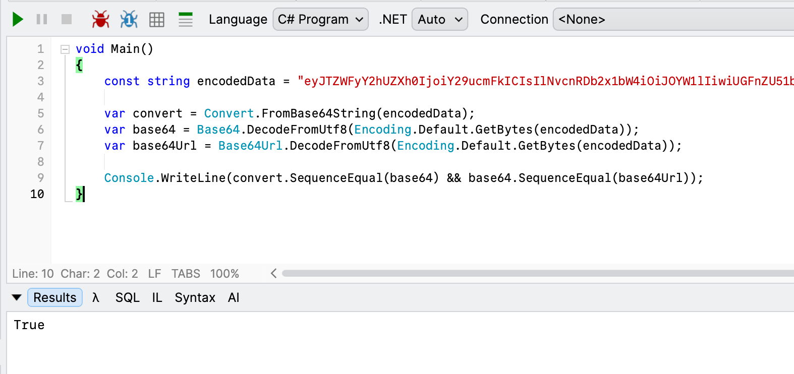
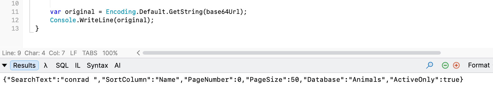

In a previous post, "[How to Encode Base64 Data In C# & .NET]()", we looked at how to correctly **encode** arbitrary data in [Base64](https://en.wikipedia.org/wiki/Base64) for representation and transmission as **text**

In this post, we will look at the **opposite** - how to **decode** `Base64` data

Here, like before, we have **three** options:

- The [FromBase64String](https://learn.microsoft.com/en-us/dotnet/api/system.convert.frombase64string?view=net-10.0) in the [Convert](https://learn.microsoft.com/en-us/dotnet/api/system.convert?view=net-10.0) `class`.
- The [DecodeFromUtf8](https://learn.microsoft.com/en-us/dotnet/api/system.buffers.text.base64url.decodefromutf8?view=net-10.0) or [DecodeFromChars](https://learn.microsoft.com/en-us/dotnet/api/system.buffers.text.base64url.decodefromchars?view=net-10.0) in the [Base64Url](https://learn.microsoft.com/en-us/dotnet/api/system.buffers.text.base64url?view=net-10.0) `class`
- The [DecodeFromUtf8](https://learn.microsoft.com/en-us/dotnet/api/system.buffers.text.base64.decodefromutf8?view=net-10.0) method in the [Base64](https://learn.microsoft.com/en-us/dotnet/api/system.buffers.text.base64?view=net-10.0) class.

Let us use the encoded `string` form the example in our previous post:

```plaintext
eyJTZWFyY2hUZXh0IjoiY29ucmFkICIsIlNvcnRDb2x1bW4iOiJOYW1lIiwiUGFnZU51bWJlciI6MCwiUGFnZVNpemUiOjUwLCJEYXRhYmFzZSI6IkFuaW1hbHMiLCJBY3RpdmVPbmx5Ijp0cnVlfQ==
```

The code is as follows:

```c#
const string encodedData = "eyJTZWFyY2hUZXh0IjoiY29ucmFkICIsIlNvcnRDb2x1bW4iOiJOYW1lIiwiUGFnZU51bWJlciI6MCwiUGFnZVNpemUiOjUwLCJEYXRhYmFzZSI6IkFuaW1hbHMiLCJBY3RpdmVPbmx5Ijp0cnVlfQ==";

var convert = Convert.FromBase64String(encodedData);
var base64 = Base64.DecodeFromUtf8(Encoding.Default.GetBytes(encodedData));
var base64Url = Base64Url.DecodeFromUtf8(Encoding.Default.GetBytes(encodedData));
```

The result of the conversion is a [byte](https://learn.microsoft.com/en-us/dotnet/api/system.byte?view=net-10.0) [array](https://learn.microsoft.com/en-us/dotnet/csharp/language-reference/builtin-types/arrays), `byte[]`.

We can test for **equality** using the [LINQ](https://learn.microsoft.com/en-us/dotnet/csharp/linq/) [SequenceEquals](https://learn.microsoft.com/en-us/dotnet/api/system.linq.enumerable.sequenceequal?view=net-10.0) method as follows:

```c#
Console.WriteLine(convert.SequenceEqual(base64) && base64.SequenceEqual(base64Url));
```

This will print the following:



If you want the **result** back as a `string`, you can retrieve it as follows:

```c#
var original = Encoding.Default.GetString(base64Url);
Console.WriteLine(original);
```

This returns the following:



### TLDR

**There are `3` main ways to decode `Base64` data.**

The code is in my [GitHub](https://github.com/conradakunga/BlogCode/tree/master/2026-11-12%20-%20DecodeBase64).

Happy hacking!
