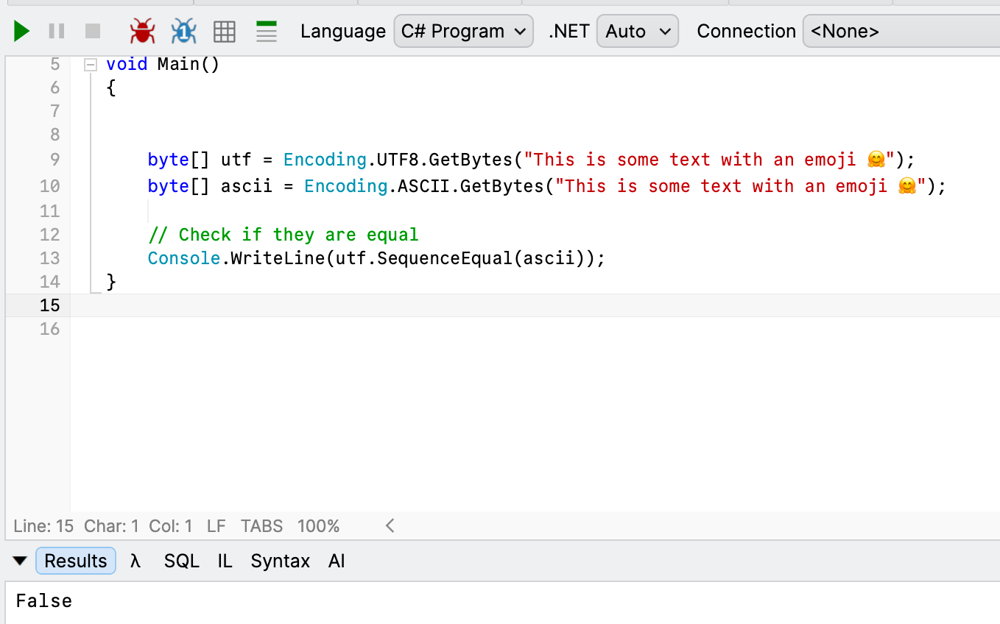
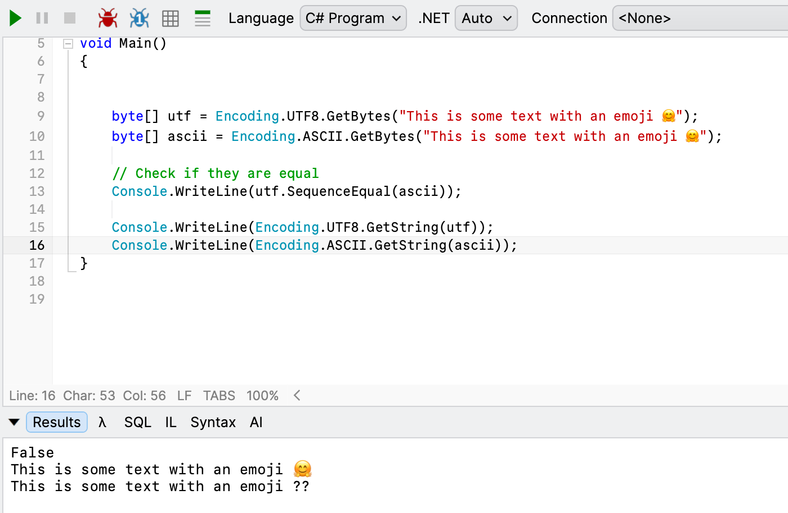

When working with text, you may probably need to work with [Encodings](https://learn.microsoft.com/en-us/dotnet/api/system.text.encoding?view=net-11.0), that represent the **persistence** and **loading** of text from **files**, **memory**, **network** and other [streams](https://learn.microsoft.com/en-us/dotnet/api/system.io.stream?view=net-10.0).

You will almost always be dealing with [UTF8](https://en.wikipedia.org/wiki/UTF-8), that is the **ubiquitous** encoding in use across operating systems.

For example, to get the byte `array` representation of **text** you would do it like this:

```c#
byte[] utf = Encoding.UTF8.GetBytes("This is some text with an emoji 🤗");
```

Here you can see I am explicitly requesting `UTF8`.

There are others that you may **occasionally** need to use directly, like [ASCII](https://en.wikipedia.org/wiki/ASCII).

```c#
byte[] ascii = Encoding.ASCII.GetBytes("This is some text with an emoji 🤗");
```

In [some]() [previous]() [posts](), we have worked with `ASCII` to do [Base64](https://en.wikipedia.org/wiki/Base64) encoding.

At which point we can ask ourselves - what is the **difference**?

We can check  if these two are the same like this:

```c#
// Check if they are equal 
Console.WriteLine(utf.SequenceEqual(ascii));
```

This will print `false`.



Why?

We can see the reason if we try and retrieve the `string` from the **encoded** `bytes`.



We can see here that the `ASCII` encoding is **unable to preserve the emoji**. This is because the emoji (being `32` bit) is not representable in `ASCII` (which is `7` bit).

This is why the **encoding when dealing with data matters**.

You will find, in some examples code, logic like this:

```c#
byte[] utf = Encoding.Default.GetBytes("This is some text with an emoji 🤗");
```

What does this [Encoding.Default](https://learn.microsoft.com/en-us/dotnet/api/system.text.encoding.default?view=net-10.0) refer to?

In .NET Core, and later versions, this is **always** [UTF8](https://learn.microsoft.com/en-us/dotnet/api/system.text.encoding.utf8?view=net-10.0). In .NET Framework (**Windows** Only!), it would return t**he encoding that corresponds to the system's active code page**.

### TLDR

`Encoding.Default` is generally synonomous with `Encoding.UTF8`

Happy hacking!
