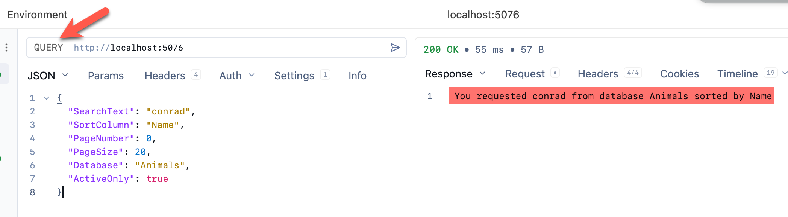
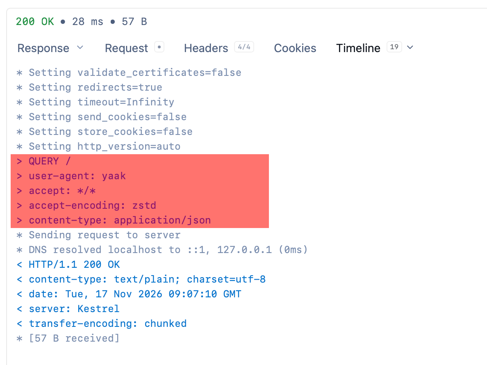

In a previous post, "[What Problem Does HTTP QUERY Solve?]()", we discussed the [HTTP QUERY](https://developer.mozilla.org/en-US/docs/Web/HTTP/Reference/Methods/QUERY) method, and how it makes a whole class of APIs and applications easier to **design** and **build**.

In today's post, we will look at how to implement one **in practice** using ASP.NET Minimal API.

For this we will use the example from an earlier post, "[How To Encode An Object For Passing In A URL In C# & .NET]()", that has this payload:

```json
{
  "SearchText": "conrad",
  "SortColumn": "Name",
  "PageNumber": 0,
  "PageSize": 20,
  "Database": "Animals",
  "ActiveOnly": true
}
```

Which we map to this `class`:

```c#
public sealed class SearchRequest
{
  public required string SearchText { get; init; }
  public required string SortColumn { get; init; }
  public required int PageNumber { get; init; }
  public required int PageSize { get; init; }
  public required string Database { get; init; }
  public required bool ActiveOnly { get; init; }
}
```

We start by generating an **empty API project**.

```bash
dotnet new web -o QueryAPI
```

The code is as follows:

```c#
var builder = WebApplication.CreateBuilder(args);
var app = builder.Build();

app.MapMethods("/", [HttpMethods.Query],
    (SearchRequest request) =>
    {
        var response =
            $"You requested {request.SearchText} from database {request.Database} sorted by {request.SortColumn}";
        return response;
    });

app.Run();
```

Unlike the other well-known methods, [GET](https://developer.mozilla.org/en-US/docs/Web/HTTP/Reference/Methods/GET), [POST](https://developer.mozilla.org/en-US/docs/Web/HTTP/Reference/Methods/POST), [PUT](https://developer.mozilla.org/en-US/docs/Web/HTTP/Reference/Methods/PUT), [DELETE](https://developer.mozilla.org/en-US/docs/Web/HTTP/Reference/Methods/DELETE), [PATCH,](https://developer.mozilla.org/en-US/docs/Web/HTTP/Reference/Methods/PATCH) there are no ASP.NET equivalents ([MapGet](https://learn.microsoft.com/en-us/dotnet/api/microsoft.aspnetcore.builder.endpointroutebuilderextensions.mapget?view=aspnetcore-10.0), [MapPost](https://learn.microsoft.com/en-us/dotnet/api/microsoft.aspnetcore.builder.endpointroutebuilderextensions.mappost?view=aspnetcore-10.0), [MapPut](https://learn.microsoft.com/en-us/dotnet/api/microsoft.aspnetcore.builder.endpointroutebuilderextensions.mapput?view=aspnetcore-10.0), [MapDelete](https://learn.microsoft.com/en-us/dotnet/api/microsoft.aspnetcore.builder.endpointroutebuilderextensions.mapdelete?view=aspnetcore-10.0), [MapPatch](https://learn.microsoft.com/en-us/dotnet/api/microsoft.aspnetcore.builder.endpointroutebuilderextensions.mappatch?view=aspnetcore-10.0)) for [QUERY](https://developer.mozilla.org/en-US/docs/Web/HTTP/Reference/Methods/QUERY). At least **not yet**.

We therefore have to use the generic [MapMethods](https://learn.microsoft.com/en-us/dotnet/api/microsoft.aspnetcore.builder.endpointroutebuilderextensions.mapmethods?view=aspnetcore-10.0) and specify our method directly.

```c#
app.MapMethods("/", [HttpMethods.Query],
    (SearchRequest request) =>
{
	// Our logic here
}
```

The logic itself is pretty standard. Ideally within we would do whatever **database access** that was required, or fetching from an **application-level cache**.

We can then try this out with an API client.

As usual, [Yaak](https://yaak.app/) is my go-to:



Here we can see that our query has been successfully submitted and responded to.

The **raw request** is as follows:



For obvious reasons, **a body is mandatory**.

### TLDR

**ASP.NET supports building of API and Web endpoints supporting `HTTP QUERY`**

The code is in my [GitHub](https://github.com/conradakunga/BlogCode/tree/master/2026-11-15%20-%20QueryAPI).

Happy hacking!
