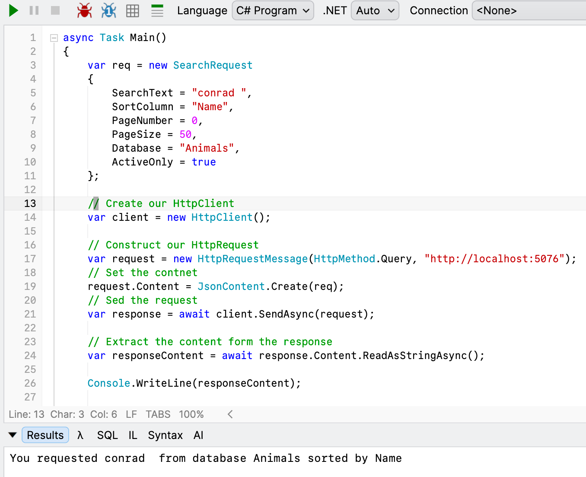

In our previous post, "[Creating A Web API Method That Supports QUERY In C# & .NET]()", we looked at how to write a server side API to handle a [HTTP Query](https://developer.mozilla.org/en-US/docs/Web/HTTP/Reference/Methods/QUERY) request.

In this post we will look at how to send a `HTTP QUERY` request from a [HttpClient](https://learn.microsoft.com/en-us/dotnet/api/system.net.http.httpclient?view=net-10.0).

For this we will use our example from [yesterday's]() post.

```json
{
  "SearchText": "conrad",
  "SortColumn": "Name",
  "PageNumber": 0,
  "PageSize": 20,
  "Database": "Animals",
  "ActiveOnly": true
}
```

Which we map to this `class`:

```c#
public sealed class SearchRequest
{
  public required string SearchText { get; init; }
  public required string SortColumn { get; init; }
  public required int PageNumber { get; init; }
  public required int PageSize { get; init; }
  public required string Database { get; init; }
  public required bool ActiveOnly { get; init; }
}
```

The initial step, **constructing the request**, as well as a [HttpClient](https://learn.microsoft.com/en-us/dotnet/api/system.net.http.httpclient?view=net-10.0) is simple enough:

```c#
var req = new SearchRequest
{
  SearchText = "conrad ",
  SortColumn = "Name",
  PageNumber = 0,
  PageSize = 50,
  Database = "Animals",
  ActiveOnly = true
};

// Create our HttpClient
var client = new HttpClient();
```

From here, things take a different turn.

For a [POST](https://developer.mozilla.org/en-US/docs/Web/HTTP/Reference/Methods/POST) request, the code would be as simple as this:

```c#
var reponse = client.PostAsJsonAsync("http://localhost:5076", req);
```

The magic here is in the [PostAsJsonAsync](https://learn.microsoft.com/en-us/dotnet/api/system.net.http.json.httpclientjsonextensions.postasjsonasync?view=net-11.0-pp) method that does the following:

- Serializes the object to `JSON`
- Constructs a [HttpRequestMessage](https://learn.microsoft.com/en-us/dotnet/api/system.net.http.httprequestmessage?view=net-10.0)
- Sends the **request** as `POST`
- **Retrieves** the **response**

However there is no such method for a [QUERY](https://developer.mozilla.org/en-US/docs/Web/HTTP/Reference/Methods/QUERY) request. At least, not yet.

Se we have to do the heavy lifting **ourselves**, like so:

```c#
// Construct our HttpRequest
var request = new HttpRequestMessage(HttpMethod.Query, "http://localhost:5076");
// Set the contnet
request.Content = JsonContent.Create(req);
// Sed the request
var response = await client.SendAsync(request);

// Extract the content form the response
var responseContent = await response.Content.ReadAsStringAsync();

Console.WriteLine(responseContent);
```

If we run this code, we should get the expected result:



### TLDR

**You can send `HTTP QUERY` requests using a `HttpClient`.**

The code is in my [GitHub](https://github.com/conradakunga/BlogCode/tree/master/2026-11-16%20-%20HttpClientQuery).

Happy hacking!
