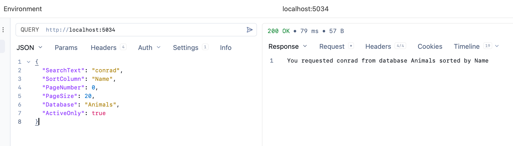

In our previous post, "[Creating A Web API Method That Supports QUERY In C# & .NET]()", we looked at how to build a [minimal API](https://learn.microsoft.com/en-us/aspnet/core/fundamentals/minimal-apis?view=aspnetcore-10.0) that can process a [HTTP QUERY](https://developer.mozilla.org/en-US/docs/Web/HTTP/Reference/Methods/QUERY) request,

In this post, we will look at how to achieve the same thing using the [Carter](https://github.com/CarterCommunity/Carter) library.

For this, we will use the same example as before:

This is the payload:

```json
{
  "SearchText": "conrad",
  "SortColumn": "Name",
  "PageNumber": 0,
  "PageSize": 20,
  "Database": "Animals",
  "ActiveOnly": true
}
```

It is mapped to this `class`:

```c#
public sealed class SearchRequest
{
  public required string SearchText { get; init; }
  public required string SortColumn { get; init; }
  public required int PageNumber { get; init; }
  public required int PageSize { get; init; }
  public required string Database { get; init; }
  public required bool ActiveOnly { get; init; }
}
```

The first step is to set up the project, an empty **Web** project:

```bash
dotnet new web -o QueryCarterAPI
```

Next we add the `Carter` package

```bash
dotnet add package Carter
```

Next, we wire up `Carter` into the setup, in `Program.cs`

```c#
using Carter;

var builder = WebApplication.CreateBuilder(args);
builder.Services.AddCarter();

var app = builder.Build();
app.MapCarter();

await app.RunAsync();
```

Finally, we write our **module** by implementing the `ICarterModule` interface:

```c#
using Carter;

namespace QueryCarterAPI;

public class SearchModule : ICarterModule
{
    public void AddRoutes(IEndpointRouteBuilder app)
    {
        app.MapMethods("/", [HttpMethods.Query], (SearchRequest request) =>
        {
            var response =
                $"You requested {request.SearchText} from database {request.Database} sorted by {request.SortColumn}";
            return response;
        });
    }
}
```

The magic is happening **here**, where we **register our route**:

```c#
 app.MapMethods("/", [HttpMethods.Query], (SearchRequest request) =>
{
  	// Logic here
}
```

You can see here the code is exactly the same as that of the **Minimal API**, as `Carter` is just a thin **wrapper** over the same.

A quick test using an API client like [Yaak]() (my go-to!) should show the following:



### TLDR

**You can register methods using `HTTP QUERY` with `Carter`.**

The code is in my [GitHub](https://github.com/conradakunga/BlogCode/tree/master/2026-11-17%20-%20QueryCarterAPI).

Happy hacking!
