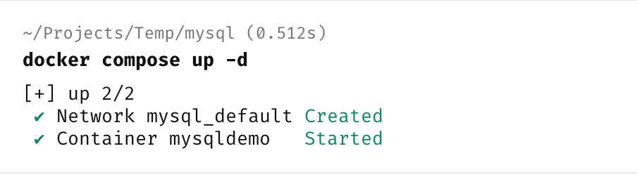
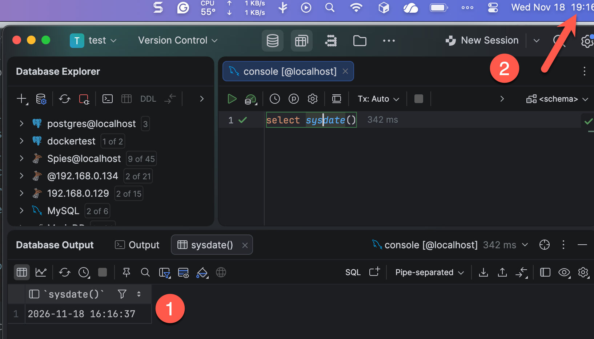
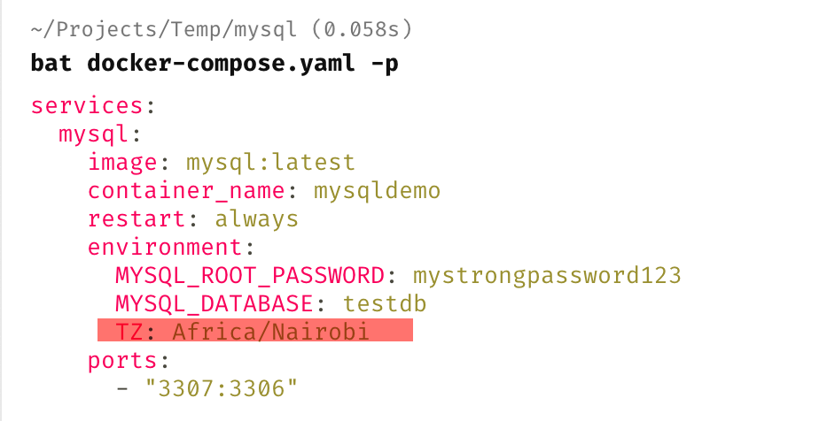
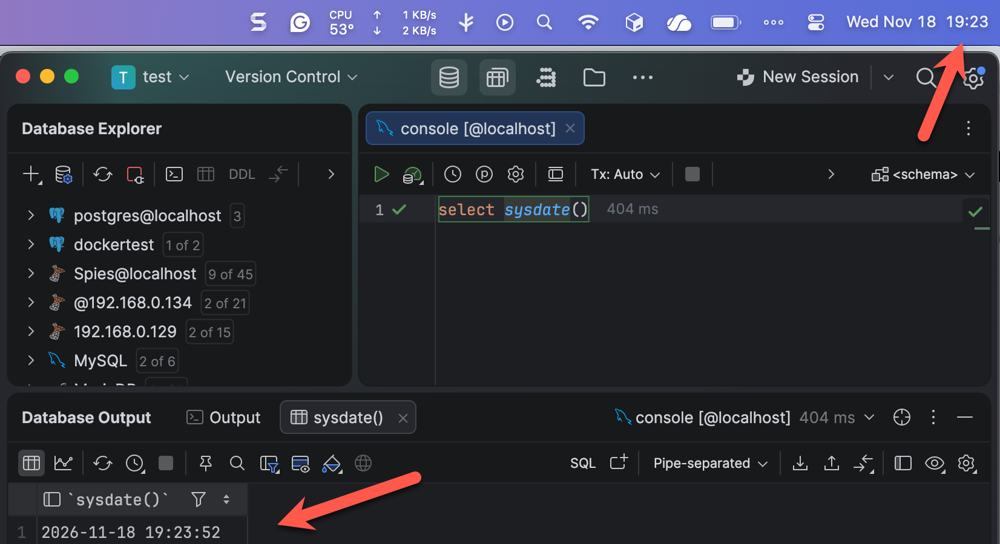

If you are not using [containers](https://www.docker.com/resources/what-container/) for your infrastructure, I would be **surprised**. **A whole class of problems and complications go away when your infrastructure is a container** that can quickly be spun up as needed.

For example, if I needed a [MySQL](https://www.mysql.com/) container, I could use this `docker-compose.yaml` file:

```yaml
services:
  mysql:
    image: mysql:latest
    container_name: mysqldemo
    restart: always
    environment:
      MYSQL_ROOT_PASSWORD: mystrongpassword123
      MYSQL_DATABASE: testdb
    ports:
      - "3307:3306"
```

Let us quickly spin this up:

```bash
docker compose up -d
```



Looks ok.

Now let us get the **system time** from that container.



We can see here that in the container the time is `16:16` but on the host it is `19:16`.

This is because **containers default to UTC** unless told otherwise

This **matters** when your **host** is interacting with the **container**!

It is therefore crucial to **remember to set the timezone in the container**.

**Most containers** will allow you to set this through an [environment variable](https://docs.docker.com/compose/how-tos/environment-variables/set-environment-variables/), `TZ`.

Like so:

```yaml
services:
  mysql:
    image: mysql:latest
    container_name: mysqldemo
    restart: always
    environment:
      MYSQL_ROOT_PASSWORD: mystrongpassword123
      MYSQL_DATABASE: testdb
      TZ: Africa/Nairobi
    ports:
      - "3307:3306"
```

The change is here:



Let us now **rebuild** our container:

```bash
docker compose up -d --build 
```

This will **stop**, **recreate** the container and then **restart** it.

Now, if we query the date:



Here we can see that they **match**.

Be in the habit of setting this in **all your containers**.

### TLDR

**When setting up containers, it is good practice to set the time zone.**

Happy hacking!!
