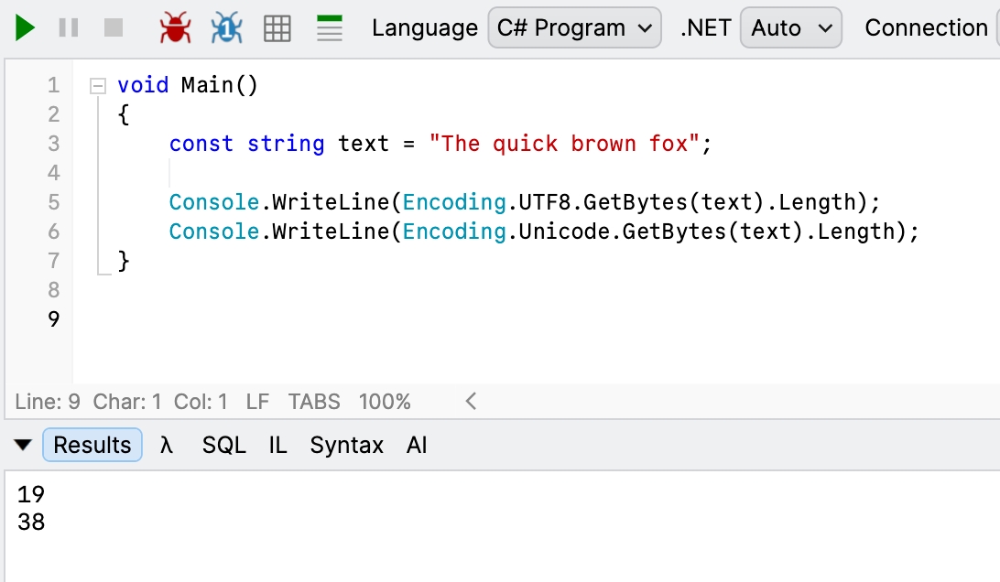
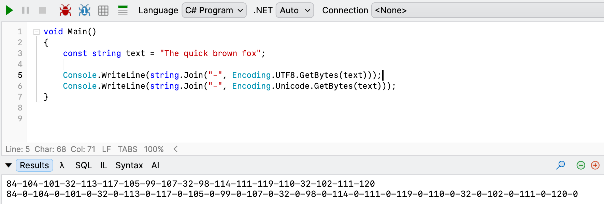

In some previous posts, "[What Is Encoding.Default In C# & .NET]()" and "[How to do Mass Base64 Encoding In C# & .NET]()", we looked at the role of [encoding](https://en.wikipedia.org/wiki/Character_encoding) and how to achieve encoding using the various [encoding](https://learn.microsoft.com/en-us/dotnet/api/system.text.encoding?view=net-11.0) classes.

We also saw how [Encoding.Default](https://learn.microsoft.com/en-us/dotnet/api/system.text.encoding.default?view=net-10.0) is the same as [Encoding.UTF8](https://learn.microsoft.com/en-us/dotnet/api/system.text.encoding.utf8?view=net-10.0), which are encodings that support [Unicode](https://en.wikipedia.org/wiki/Unicode).

However, there is also a class that can potentially lead to confusion - [Encoding.Unicode](https://learn.microsoft.com/en-us/dotnet/api/system.text.encoding.unicode?view=net-10.0), which is also a `Unicode` compliant encoding. However, they are **not the same thing**!

Let us start with some text to encode:

```c#
const string text = "The quick brown fox";
```

We can encode it using both encodings as follows:

```c#
Console.WriteLine(Encoding.UTF8.GetBytes(text).Length);
Console.WriteLine(Encoding.Unicode.GetBytes(text).Length);
```

If we run this code, we see the following:



We can see here that `UTF8` is half the size of `Unicode`

Curious.

We can get a better picture when we view the bytes:

```c#
const string text = "The quick brown fox";

Console.WriteLine(string.Join("-", Encoding.UTF8.GetBytes(text)));
Console.WriteLine(string.Join("-", Encoding.Unicode.GetBytes(text)));
```



Here we can see that for `Unicode`, each character is represented by **two** bytes.

Hence `T`, that is `84` in binary, is represented in one byte in `UTF8`.

In `Unicode` **Encoding**, it is `84-00`.

This is exactly why the size is **double**, at least for the text presented.

It is not this simple always, as we will see in the next post.

### TLDR

**`UTF8` encoding uses `1` to 4 bytes (depending on what is being represented).`Unicode` encoding uses 2- `4`.**
