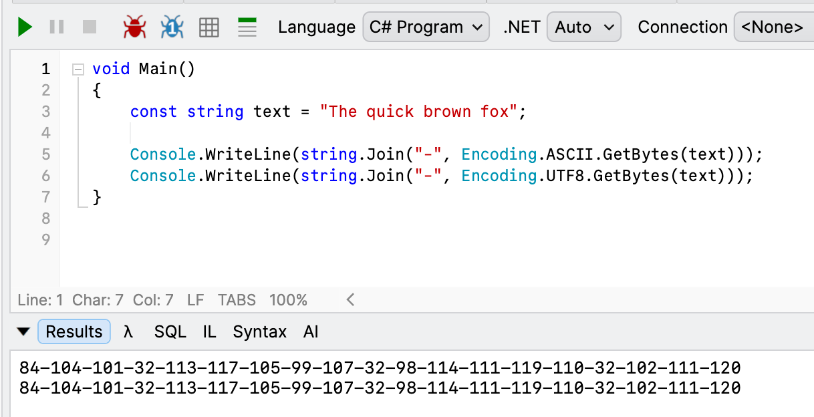
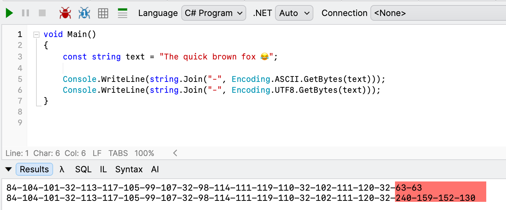

In our previous post, "[UTF8 vs Unicode Encoding In C# & .NET]()", we looked at the difference (and the relationship) between [UTF8 Encoding](https://learn.microsoft.com/en-us/dotnet/api/system.text.encoding.utf8?view=net-10.0) and [Unicode Encoding](https://learn.microsoft.com/en-us/dotnet/api/system.text.encoding.default?view=net-10.0).

In this post, we shall look at the relationship between [ASCII](https://learn.microsoft.com/en-us/dotnet/api/system.text.encoding.ascii?view=net-11.0) and `UTF8 Encoding.`

Let us look at our cipher text:

```c#
const string text = "The quick brown fox";
```

We can encode both using ASCII and Unicode encoding:

```c#
const string text = "The quick brown fox";

Console.WriteLine(string.Join("-", Encoding.ASCII.GetBytes(text)));
Console.WriteLine(string.Join("-", Encoding.UTF8.GetBytes(text)));
```



Straight away, we see the beauty behind the design of UTF8 - all ASCII encoded files are UTF8 compatible, provided the text to encode is in fact ASCII.

Should you try anything that is not ASCII, you get a problem.

Take the following:

```c#
const string text = "The quick brown fox 😂";

Console.WriteLine(string.Join("-", Encoding.ASCII.GetBytes(text)));
Console.WriteLine(string.Join("-", Encoding.UTF8.GetBytes(text)));
```

We can see here that there is an emoji at the end of our cipher-text.

This returns the following:



We can see here that the emoji requires 4 `bytes` to encode, which cannot be done in `ASCII`, where each character is stored in 8 `bits` (1 `byte`).

This means that any editor that can open UTF8 files can open ASCII files.

### TLDR

**`ASCII` is 100% compatible with `UTF8`, as any character can be encoded in `ASCII` encodes to the same character in `UTF8`.**

Happy hacking!
