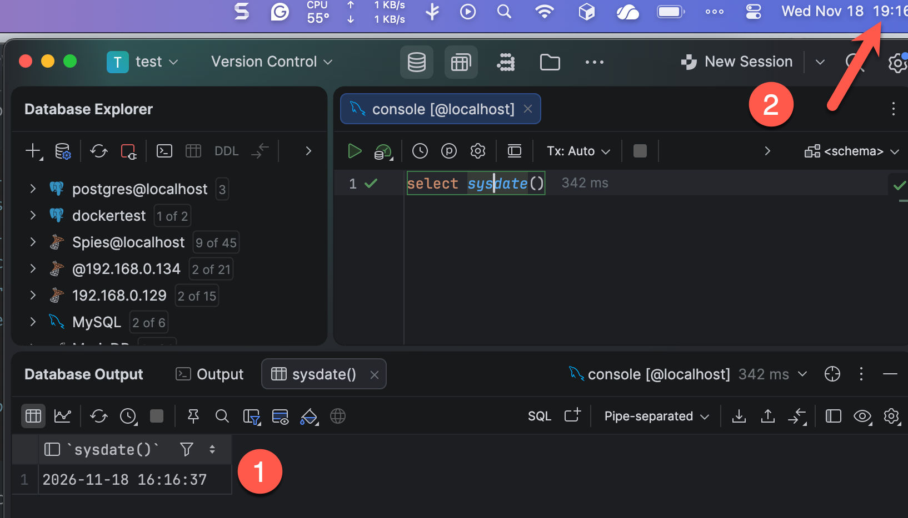
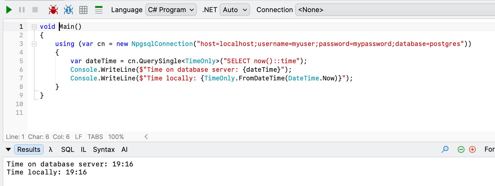
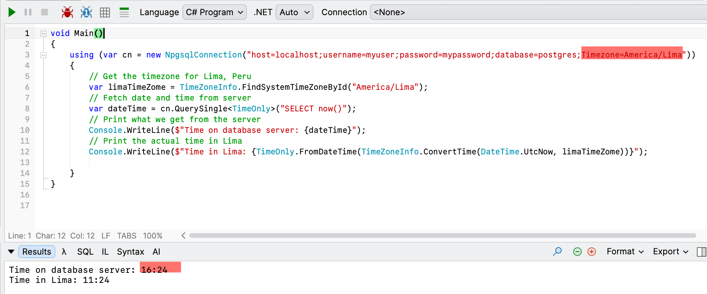
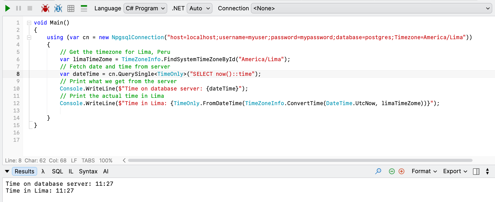

In a previous post, "[Setting Time Zones In Your Docker Containers]()", we looked at how to set the time zone for the server in [PostgreSQL](https://www.postgresql.org/).

We could then query the database in the container from the server, like so:



This looks like the end of the discussion.

But isn't.

Let us try and connect to the server and retrieve the time using code.

For this we need the following packages:

- [NpgSql](https://github.com/npgsql/npgsql)
- [Dapper](https://github.com/dapperlib/dapper)

We then write code like this:

```c#
using (var cn = new NpgsqlConnection("host=localhost;username=myuser;password=mypassword;database=postgres"))
{
  var dateTime = cn.QuerySingle<TimeOnly>("SELECT now()::time");
  Console.WriteLine($"Time on database server: {dateTime}");
  Console.WriteLine($"Time locally: {TimeOnly.FromDateTime(DateTime.Now)}");
}	
```

This returns the following:



Looks ok.

Now suppose the client was in a different time zone.

Let us say, the client was in Lima, Peru.

We can inform the server where we are connecting from like this:

```c#
using (var cn = new NpgsqlConnection("host=localhost;username=myuser;password=mypassword;database=postgres;Timezone=America/Lima"))
{
  // Get the timezone for Lima, Peru	
  var limaTimeZome = TimeZoneInfo.FindSystemTimeZoneById("America/Lima");
  // Fetch date and time from server
  var dateTime = cn.QuerySingle<TimeOnly>("SELECT now()");
  // Print what we get from the server
  Console.WriteLine($"Time on database server: {dateTime}");
  // Print the actual time in Lima
  Console.WriteLine($"Time in Lima: {TimeOnly.FromDateTime(TimeZoneInfo.ConvertTime(DateTime.UtcNow, limaTimeZome))}");
}
```

This prints the following:



Which is wrong!

The problem is here:

```c#
 var dateTime = cn.QuerySingle<TimeOnly>("SELECT now()");
```

The `NpgSql` driver always sends this as `UTC 0` unless you tell it otherwise. You do this as follows:

```c#
 var dateTime = cn.QuerySingle<TimeOnly>("SELECT now()::time");
```



You can also do this conversion on the **client** side, as follows:

```c#
using (var cn = new NpgsqlConnection("host=localhost;username=myuser;password=mypassword;database=postgres;Timezone=America/Lima"))
	{
		// Get the timezone for Lima, Peru	
		var limaTimeZome = TimeZoneInfo.FindSystemTimeZoneById("America/Lima");
		// Fetch date and time from server
		var dateTime = cn.QuerySingle<DateTime>("SELECT now()");
		// Print what we get from the server
		Console.WriteLine($"Time on database server: {TimeOnly.FromDateTime(TimeZoneInfo.ConvertTime(dateTime, limaTimeZome))}");
		// Print the actual time in Lima
		Console.WriteLine($"Time in Lima: {TimeOnly.FromDateTime(TimeZoneInfo.ConvertTime(DateTime.UtcNow, limaTimeZome))}");
	}
```

### TLDR

**Over and above the timezone of the server, you must also factor in the time zone of the client when you need to fetch the server time for computations.**

The code is in my GitHub.

Happy hacking!
