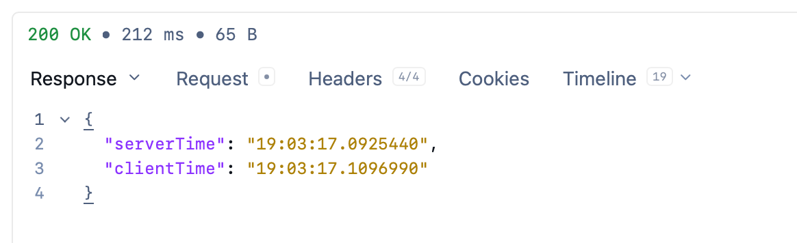
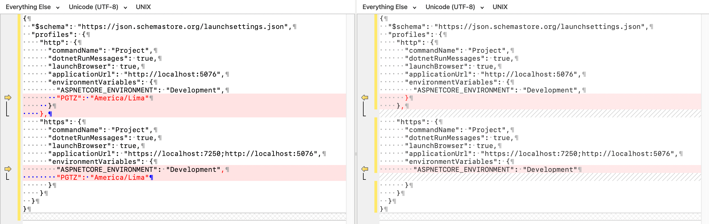
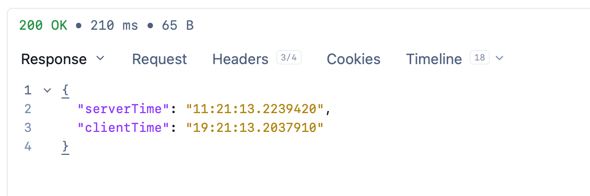

In our previous post, "[Getting the Server Time in PostgreSQL From A Client In A Different Timezone in C# & .NET]()", we looked at how to get the server time in [PostgreSQL](https://www.postgresql.org/) and have it correctly displayed in the **timezone of the client**.

The code was like so:

```c#
using (var cn = new NpgsqlConnection("host=localhost;username=myuser;password=mypassword;database=postgres;Timezone=America/Lima"))
{
  // Get the timezone for Lima, Peru	
  var limaTimeZome = TimeZoneInfo.FindSystemTimeZoneById("America/Lima");
  // Fetch date and time from server
  var dateTime = cn.QuerySingle<DateTime>("SELECT now()");
  // Print what we get from the server
  Console.WriteLine($"Time on database server: {TimeOnly.FromDateTime(TimeZoneInfo.ConvertTime(dateTime, limaTimeZome))}");
  // Print the actual time in Lima
  Console.WriteLine($"Time in Lima: {TimeOnly.FromDateTime(TimeZoneInfo.ConvertTime(DateTime.UtcNow, limaTimeZome))}");
}
```

Which works ok.

The problem with this approach is that **you have to keep setting the timezone at the connection level**, which can be a source of bugs if you don't maintain **centralized** connection strings.

A solution to this is to have the timezone set at **application level**.

Let us look at a sample web API:

```c#
var builder = WebApplication.CreateBuilder(args);
builder.Services.AddSerilog();
var app = builder.Build();

app.MapGet("/", () =>
{
    using (var cn = new NpgsqlConnection("host=localhost;username=myuser;password=mypassword;database=postgres"))
    {
        var serverTime = cn.QuerySingle<TimeOnly>("SELECT now()::time");
        var clientTime = TimeOnly.FromDateTime(DateTime.Now);
        Log.Information("Time on database server: {ServerTime}", serverTime);
        Log.Information("Time locally: {ClientTime}", clientTime);
        return Results.Ok(new { ServerTime = serverTime, ClientTime = clientTime });
    }
});

await app.RunAsync();
```

If we run this code we get the following result:



Suppose we wanted to simulate that the **client** is in a **different time zone**, say Lima, Peru?

We can make use of the fact that the PostgreSQL client driver supports the `PGTZ` [environment variable](https://www.postgresql.org/docs/current/datatype-datetime.html).

There are several ways to set it, but the simplest is to set it in the `launchSettings.json` file.

By default, it looks like this:

```json
{
  "$schema": "https://json.schemastore.org/launchsettings.json",
  "profiles": {
    "http": {
      "commandName": "Project",
      "dotnetRunMessages": true,
      "launchBrowser": true,
      "applicationUrl": "http://localhost:5076",
      "environmentVariables": {
        "ASPNETCORE_ENVIRONMENT": "Development",
      }
    },
    "https": {
      "commandName": "Project",
      "dotnetRunMessages": true,
      "launchBrowser": true,
      "applicationUrl": "https://localhost:7250;http://localhost:5076",
      "environmentVariables": {
        "ASPNETCORE_ENVIRONMENT": "Development"
      }
    }
  }
}

```

We can update it to look like this:

```json
{
  "$schema": "https://json.schemastore.org/launchsettings.json",
  "profiles": {
    "http": {
      "commandName": "Project",
      "dotnetRunMessages": true,
      "launchBrowser": true,
      "applicationUrl": "http://localhost:5076",
      "environmentVariables": {
        "ASPNETCORE_ENVIRONMENT": "Development",
        "PGTZ": "America/Lima"
      }
    },
    "https": {
      "commandName": "Project",
      "dotnetRunMessages": true,
      "launchBrowser": true,
      "applicationUrl": "https://localhost:7250;http://localhost:5076",
      "environmentVariables": {
        "ASPNETCORE_ENVIRONMENT": "Development",
        "PGTZ": "America/Lima"
      }
    }
  }
}
```

The difference is here:



If we now run the app, we get the following:



We can see here that the **timezone at the client is respected**.

### TLDR

**You can set the timezone for the connecting client application globally using the PGTZ environment variable.**

The code is in my GitHub.

Happy hacking!
