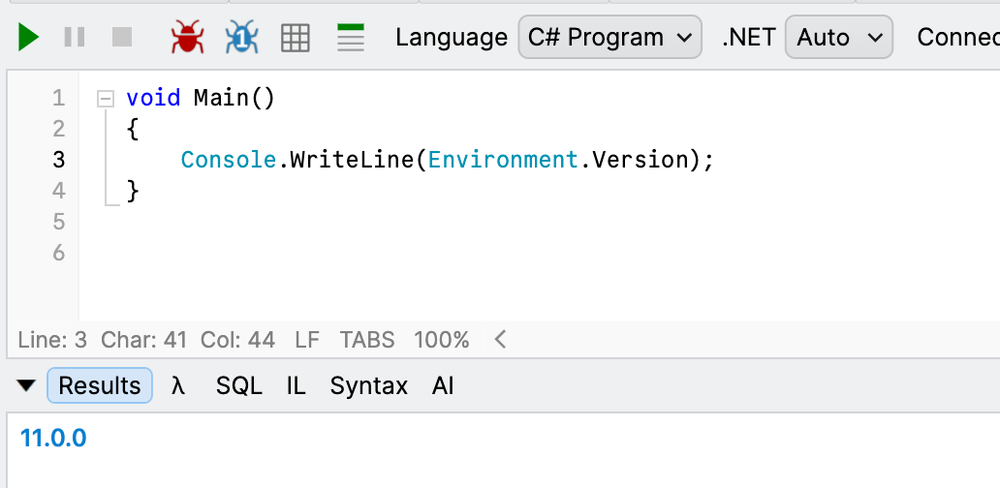

Recently, while building a small utility, I need to check the version of the [.NET runtime](https://groovetechnology.com/blog/technologies/in-depth-guide-to-understanding-the-net-runtime/) that it was running under. 

The quickest way is to consult the [Environment.Version](https://learn.microsoft.com/en-us/dotnet/api/system.environment.version?view=net-11.0) property.

```c#
Console.WriteLine(Environment.Version);
```



If you need more **granular** information, you can check

- [Major](https://learn.microsoft.com/en-us/dotnet/api/system.version.major?view=net-11.0)
- [Minor](https://learn.microsoft.com/en-us/dotnet/api/system.version.minor?view=net-11.0)
- [Major revision](https://learn.microsoft.com/en-us/dotnet/api/system.version.majorrevision?view=net-11.0)
- [Minor revision](https://learn.microsoft.com/en-us/dotnet/api/system.version.minorrevision?view=net-11.0)

This is because what is returned is a [version](https://learn.microsoft.com/en-us/dotnet/api/system.version?view=net-11.0) object.

### TLDR

**You can query the .NET version running from the `Environment.Version` property.**

Happy hacking!
